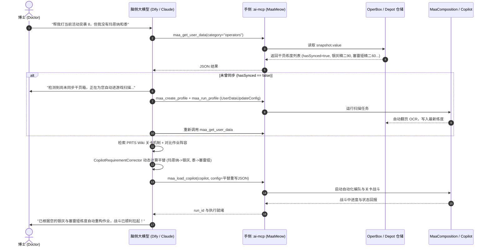

# 账户个性化与练度自适应架构 (Account Personalization & Roster Adaptation)

> **核心哲学**：拒绝千篇一律的死板配置，为每一位独一无二的博士定制专属自动化决策。

---

## 1. 痛点：千人千面，每个人的干员与练度都不一样

在明日方舟的日常自动化与活动通关场景中，**干员阵容与练度的个体差异（Account Heterogeneity）** 始终是阻碍智能助理落地的最大痛点：

1. **干员持有情况各不相同**：
   - 资深玩家全图鉴，而新手或回归博士缺少关键幻神（如维什戴尔、玛恩纳、史尔特尔、黍、纯金年代等）；
   - PRTS 作业站与 B 站攻略主流作业往往强依赖特定 6 星干员，一旦缺少其中一人，普通玩家便束手无策。
2. **练度分化严重**：
   - 同样拥有银灰，有的玩家是「精二 90 级、三技能专精 3、模组 3 级」，有的玩家则是「精一 50 级、技能 7 级」；
   - 作业中的下怪时机和技能轴往往针对特定练度调校。练度偏低可能伤害不足导致漏怪，练度过高（如过早击杀敌人）也可能导致技能轴紊乱提早进入下一波怪。
3. **传统方案的割裂与低效**：
   - 传统脚本平台要求用户在网页端手工逐一勾选几百名干员的精英化与等级，耗时费力且极易遗漏；
   - 桌面级 ADB 脚本无法获取游戏内存与本地仓储数据，只能“盲跑”，一旦卡关便直接翻车。

为了实现真正的「自动自适应智能体」，MaaMeow 在架构上设计了 **四层账户个性化闭环**：

```
[玩家游戏账户 (Game)] 
       │ 
       ▼ (解法 3: UserDataUpdateConfig 原生无感扫描)
[原生数据仓储 (OperBoxRepository & DepotRepository)] ── (解法 1: 本地类型安全仓储)
       │
       ▼ (解法 2: maa_get_user_data MCP 透传与智能裁剪)
[大语言模型 Agent (脑侧 Dify / Claude)]
       │
       ▼ (解法 4: CopilotRequirementCorrector 动态平替校正)
[MaaCompositionService / Copilot 作战引擎 (手侧执行)]
```

---

## 2. 解法 1：原生干员箱与仓库仓储 (`OperBoxRepository` + `DepotRepository`)

MaaMeow 在 Android 端原生维护了两位核心仓储组件，负责持久化管理博士的个人数字资产：

### 2.1 干员箱仓储 (`OperBoxRepository`)
`OperBoxRepository` 维护了玩家的干员阵容快照（`OperBoxSnapshot`）：
- **状态元数据**：
  - `hasSynced: Boolean`：标记当前设备是否已成功完成过干员箱同步；
  - `syncTimeMillis: Long`：最近一次同步的绝对时间戳（用于评估数据新鲜度）。
- **干员实体结构 (`OperBoxOperator`)**：
  ```kotlin
  data class OperBoxOperator(
      val id: String,                 // 稳定内部 ID，如 "char_103_silverash"
      val name: String,               // 中文名称，如 "银灰"
      val rarity: Int,                // 星级 1-6
      val elite: Int,                 // 精英化等级 0, 1, 2
      val level: Int,                 // 当前等级 (1-90)
      val potential: Int,             // 潜能等级 (1-6)
      val skills: List<OperatorSkill>,// 各技能专精情况 (specializeLevel: 0-3)
      val equips: List<OperatorEquip>,// 已解锁模组与等级 (level: 1-3)
  )
  ```

### 2.2 仓库仓储 (`DepotRepository`)
`DepotRepository` 维护了博士的全部背包材料、货币与体力药剂快照：
- 结合内部 `ItemHelper` 与 `item_index.json`，将游戏内部掉落物 ID（如 `"30012"`）与标准名称（`"固源岩"`、`"聚合剂"`、`"龙门币"`）双向绑定；
- 记录当前持有数量，为大模型的材料规划、活动收益分析和基建制造提供底层数据依据。

---

## 3. 解法 2：实时练度透传工具 (`maa_get_user_data`)

大语言模型（如 Dify、Claude Desktop）通过 `:ai-mcp` 暴露的标准 MCP 工具 `maa_get_user_data`，按需实时读取玩家的真实练度底账。

### 3.1 接口参数与灵活筛选机制

| 参数名 | 类型 | 必填 | 默认值 | 语义与用途 |
|---|:---:|:---:|:---:|---|
| `category` | `string` | 否 | `"all"` | 查询范畴：`"operators"`（仅干员箱）、`"depot"`（仅仓库物品）、`"all"`（二者皆要） |
| `filter` | `string` | 否 | `null` | 精准过滤关键词（干员中文名/ID，或物品名称/ID） |

### 3.2 上下文裁剪与 Token 优化策略
明日方舟目前拥有近 400 名干员与数百种材料。若将未加工的全量数据直接放入大模型 Context，将消耗上万 Token 甚至突破窗口上限。

为此，Agent 与工具实现了 **两级裁剪策略**：
1. **定向过滤**：当博士询问特定干员（如“我该用谁代替银灰？”）时，传入 `filter="银灰"` 或 `category="operators"`，只返回目标实体；
2. **星级与精二优先**：在通关决策时，默认过滤三星以下及未精二的三星/四星干员，重点返回 5~6 星核心主力，将 Token 消耗严格控制在 1K 以内。

### 3.3 数据透传样例

```json
{
  "operBox": {
    "hasSynced": true,
    "syncTimeMillis": 1731057600000,
    "totalCount": 248,
    "operators": [
      {
        "id": "char_103_silverash",
        "name": "银灰",
        "rarity": 6,
        "elite": 2,
        "level": 90,
        "potential": 6,
        "skills": [
          { "name": "强力击·γ型", "level": 1, "specializeLevel": 0 },
          { "name": "雪境生存法则", "level": 1, "specializeLevel": 0 },
          { "name": "真银斩", "level": 7, "specializeLevel": 3 }
        ],
        "equips": [
          { "type": "X", "level": 3 }
        ]
      },
      {
        "id": "char_010_chen",
        "name": "陈",
        "rarity": 6,
        "elite": 2,
        "level": 60,
        "potential": 2,
        "skills": [
          { "name": "鞘击", "level": 1, "specializeLevel": 0 },
          { "name": "赤霄·拔刀", "level": 7, "specializeLevel": 1 },
          { "name": "赤霄·绝影", "level": 7, "specializeLevel": 0 }
        ],
        "equips": []
      }
    ]
  },
  "depot": {
    "hasSynced": true,
    "syncTimeMillis": 1731057600000,
    "items": [
      { "id": "30012", "name": "固源岩", "count": 312 },
      { "id": "30064", "name": "改量装置", "count": 18 },
      { "id": "4001", "name": "龙门币", "count": 2450000 }
    ]
  }
}
```

---

## 4. 解法 3：未同步时全自动进游戏扫描 (`UserDataUpdateConfig`)

当博士首次使用 AI 助手，或者 `maa_get_user_data` 返回 `hasSynced == false` 时，大模型与调度器具备 **自闭环数据采集能力**：

```
[Agent 发现 hasSynced == false]
       │
       ▼ (提示博士并下发动态任务)
[maa_create_profile + maa_run_profile]
       │
       ▼ (参数挂载: UserDataUpdateConfig)
[MaaCore 自动进入游戏干员界面]
       │  - 自动滚动干员列表
       │  - OCR 识别干员名称、星级、精英等级与技能专精
       │  - 进入仓库页面扫描材料数
       ▼
[自动写入 OperBoxRepository & DepotRepository]
       │
       ▼
[重新调用 maa_get_user_data 获取精准练度]
```

### 4.1 任务节点配置示例
通过 `maa_create_profile` 下发原生数据同步任务：
```json
{
  "name": "自动扫描干员与仓库",
  "chain": [
    {
      "name": "开始唤醒",
      "type": "START_UP",
      "config": {}
    },
    {
      "name": "同步个人数据",
      "type": "USER_DATA",
      "config": {
        "updateOperBox": true,
        "updateDepot": true
      }
    }
  ]
}
```
整个过程依靠 MaaCore 的图形识别与 OCR 能力在手机端静默完成，彻底告别在网页上手动录入数百位干员的繁琐流程。

---

## 5. 解法 4：智能抄作业平替与练度校正 (`CopilotRequirementCorrector`)

当用户想要使用一份 PRTS 作业（例如 `maa://...` 或作业 JSON），但自身干员与作业要求存在偏差时，大模型结合 `CopilotRequirementCorrector` 执行动态智能校正：

### 5.1 智能平替判定矩阵
大模型根据职业分支特性、技能定位以及输出类型（物理/法术）进行同位替代：

| 作业原推荐干员 | 原要求练度 | 替代候选（依持有情况判定） | 替补策略与调整要点 |
|---|---|---|---|
| **维什戴尔** (Wis'adel) | 精二 60 级 3 技能专 3 | 提丰 (精二 60 级 S2) / 水月 / 假日威龙陈 | 覆盖同范围高台清杂，若缺少破甲余震，额外增加一名减抗辅助 |
| **玛恩纳** (Młynar) | 精二 90 级 3 技能专 3 | 银灰 (真银斩 专 3) / 棘刺 (至高之术) | 银灰兼具真银斩大范围爆发与反隐反潜天赋，可无缝承接真伤波次 |
| **史尔特尔** (Surtr) | 精二 70 级 黄昏专 3 | 耀骑士临光 (S3) / 仇白 (S3) / 异格斯卡蒂 | 空降单切或法术决战，需关注阻挡数与下场无敌帧时间 |
| **黍** (Shu) | 精二 60 级 S3 | 塞雷娅 (急救 / 钙质化) / 临光 | 庇护阻挡兼顾高频回血，调整部署格子触发相近防御收益 |

### 5.2 练度自适应与技能轴动态修正
- **练度不足时**：
  若玩家的干员等级未达标（例如作业要求精二 60 级，玩家仅精二 20 级），大模型在 Copilot 编排中自动补充 1 名低费辅助或减速控制干员（如铃兰、梓兰、波登可），提升输出容错率；
- **回转差异校正**：
  专精等级直接影响技力初动与回转时间。若专精等级低于作业要求，校正器会自动调整前置下怪的延迟时间（`delay`）或提前开启技能。

### 5.3 动态重写与下发作战
校正完成后，Agent 重新生成符合玩家当前练度的 Copilot 配置，并直接调用 `maa_load_copilot` 启动全自动作战：
```json
{
  "copilot": "https://prts.plus/copilot/12345",
  "config": {
    "overrideOperators": [
      {
        "original": "维什戴尔",
        "replacement": "提丰",
        "skillIndex": 2
      },
      {
        "original": "玛恩纳",
        "replacement": "银灰",
        "skillIndex": 3
      }
    ]
  }
}
```

---

## 6. 端到端协作时序图

以下 Mermaid 时序图展示了博士向 AI 发出自然语言求助到最终自适应完成战斗的完整闭环：



---

## 7. 架构优势小结

1. **绝对真实（Ground-Truth Grounding）**：AI 不再凭借幻觉去猜博士有哪些干员，直接从本地仓储读取经过验证的真实数据。
2. **零人工负担（Zero Manual Input）**：通过 `UserDataUpdateConfig` 原生 OCR 识别，博士完全无需在任何表单中逐个挑选干员。
3. **安全自洽（Local First & Privacy）**：干员箱与仓库数据仅保存在手机端本地 DataStore 存储中，通过加密/受权 MCP 端点提供给 Agent，杜绝隐私泄露。
4. **弹性平替（Adaptive Fallback）**：通过同职业分支平替与技能轴自适应补偿，最大化降低抄作业门槛，真正实现千人千面的贴心辅导。
