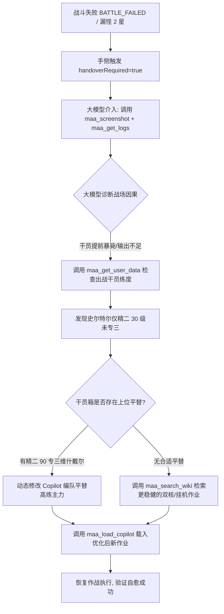
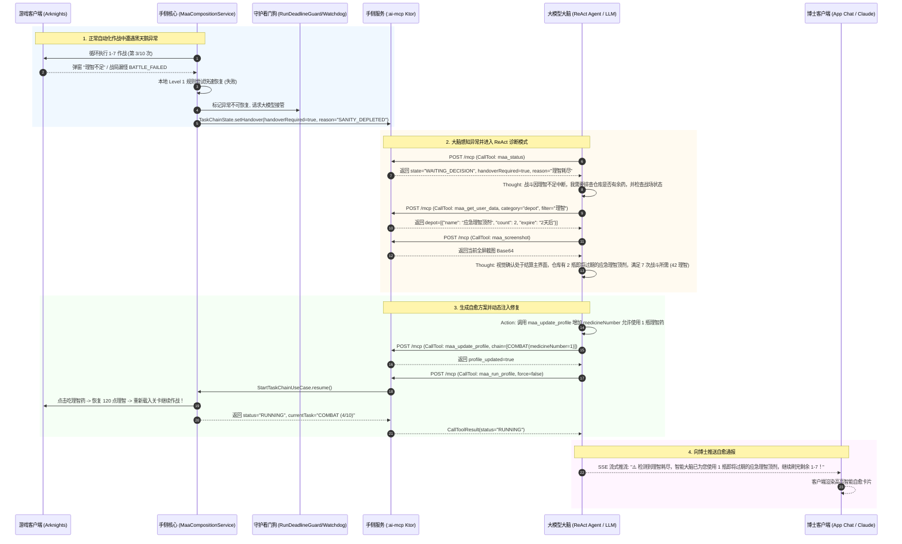

# 异常回退大模型：智能自愈与自适应兜底决策架构 (LLM Fallback & Self-Healing Decision Loop)

> **核心哲学**：让传统脚本做它最擅长的秒级机械执行，让大模型在最棘手的“黑天鹅”异常与高价值分歧点接管兜底，构建“脚本冲锋、模型兜底、自动自愈”的确定性闭环。

---

## 1. 为什么大模型是终极“异常兜底与故障自愈”专家？

在自动化技术领域，无论是工业机器人还是手游日常挂机，**长尾异常（Long-Tail Exceptions）与偶发未知状态** 始终是全自动无人值守的最大拦路虎。

### 1.1 传统脚本的阿喀琉斯之踵：写死 if-else 的机械脆弱性

传统的游戏自动化脚本（包括基于 OpenCV 模板匹配、固定坐标点击或有限状态机 FSM 的传统程序）在理想状况下表现优异，但在真实复杂的移动端生产环境中，不可避免地会遭遇大量“预期外”故障：

1. **作战代理失误与突发漏怪**：新干员机制冲突、帧率波动导致技能轴微小漂移、或官方暗改敌人移速，导致第 25 波怪漏进蓝门翻车；
2. **资源耗尽与逻辑断头路**：设定的刷理智轮数尚未完成，背包里的理智药却已提前吃光；
3. **高价值未知事件与决策分歧**：自动公招扫描出“高级资深干员”（锁定 6 星）或“支援机械”等极其稀有的 Tag 组合；
4. **全屏突发弹窗与 UI 状态脱轨**：游戏版本热更、大型活动首发、月度限时签到或突发全服停服补偿，主界面被连续 3-5 页的全屏宣传海报覆盖，状态机找不到“开始唤醒”按钮；
5. **网络抖动与偶发死循环**：基建换班时网络丢包卡在“正在连接神经突触...”加载条，或是动画未加载完成导致点击穿透。

面对上述开放式异常，**传统程序的常规应对手段只能是：**
- **机械盲目重试 (Retry Storm)**：在错误的界面重复狂点，造成网络风暴或操作漂移；
- **超时卡死等待 (Timeout Freeze)**：一直挂起直到看门狗超时，白白消耗手机电量与发热；
- **抛出异常直接摆烂 (Fail-Fast & Crash)**：直接中断后续所有未执行任务（如理智没刷完，后面的基建换班和公招也全都不做了），甚至在公招中把 6 星当普通 3 星随便点掉，造成不可逆的“血亏”。

### 1.2 大模型作为“大脑”的降维打击优势

大语言模型（LLM）与多模态大模型（Vision LLM）在定位上天然不是用来做“每秒 60 帧的高频触控”，而是作为**高维因果推理与容错决策中枢**。在 MaaMeow 的「脑手分离」架构下，大模型具备传统脚本无法企及的自愈能力：

```text
+-----------------------------------------------------------------------------------------------+
|                                    大模型自愈中枢 (Brain)                                     |
|                                                                                               |
|  +---------------------------+  +---------------------------+  +---------------------------+  |
|  |     多模态视觉理解        |  |     长上下文语境推理      |  |    PRTS 领域因果推断      |  |
|  |   (Multimodal Vision)     |  |    (Log Context Reason)   |  |   (Causal PRTS RAG)       |  |
|  | - 识别全屏活动海报弹窗    |  | - 串联百行历史操作日志    |  | - 查明漏怪根本练度原因    |  |
|  | - 毫秒定位右上角关闭叉叉  |  | - 溯源死锁发生的根本根因  |  | - 公招多词条锁定全新干员  |  |
|  | - 读懂战场阵亡干员与血线  |  | - 剔除偶发抖动与表象误报  |  | - 仓库药物规划与任务调序  |  |
|  +---------------------------+  +---------------------------+  +---------------------------+  |
+-----------------------------------------------------------------------------------------------+
                                                ▲
                                                │ MCP 协议自愈握手
                                                │ (handoverRequired=true / status=ERROR)
+-----------------------------------------------------------------------------------------------+
|                                    移动端执行内核 (Hand)                                     |
|  - libMaaCore 原生秒级识别与执行 (Level 0: 常规满速运行，0 Token 消耗)                        |
|  - AppWatchdog / RunDeadlineGuard (Level 1: 端侧轻量守护与重启)                               |
|  - 状态脱轨与高危事件主动上抛 (Level 2: 触发大模型接管自愈)                                   |
+-----------------------------------------------------------------------------------------------+
```

1. **多模态感知能力 (Multimodal Perception)**：
   借助 `maa_screenshot` 工具，大模型能直接“看懂”当前画面。无论是官方临时新增的节日海报，还是从未见过的调查问卷，多模态模型能准确识别人类意图：“这是一个关闭按钮在右上角的签到弹窗，点击 [0.93, 0.08] 即可关闭”，彻底解决 UI 状态脱轨。
2. **日志语境与因果推理能力 (Log Contextual Reasoning)**：
   借助 `maa_get_logs` 工具，大模型可以阅读近 200 行结构化诊断日志，在时间序列中寻找因果链条（“在 10:14:02 尝试进入 1-7，但 10:14:05 收到提示理智不足 6 点，因此并非关卡找不到，而是理智耗尽”），避免传统程序由于单一错误码产生的误判。
3. **PRTS 专属知识库与账户底账全局推断 (Domain-Specific Causal Inference)**：
   结合 `maa_get_user_data` 与明日方舟 RAG 知识库，大模型不仅知晓“当前发生了什么”，更知晓“怎样才是收益最大的解法”。公招遇到高资时，结合玩家当前未持有的 6 星列表，动态计算出 100% 锁定新干员的最优词条。

---

## 2. 五大典型异常回退与大模型自愈场景

在 MaaMeow 运行过程中，以下五种最具代表性的异常事件会被端侧拦截并触发大模型自愈决策闭环：

```text
==================================================================================================
  五大异常回退场景与自愈决策矩阵
==================================================================================================
  1. 理智耗尽 (Sanity Depleted)    ---> 查仓库余药 / 动态修改 medicineNumber / 智能切换下游任务
  2. 高资稀有公招 (Rare Recruit)   ---> 拦截防贱卖 / 比对干员箱图鉴 / 100% 锁定新 6 星最佳组合
  3. 战斗漏怪翻车 (Battle Failure) ---> 截图分析死因 / 查干员练度缺陷 / 检索 PRTS 更稳作业平替
  4. 突发新活动弹窗 (UI Derail)    ---> 多模态视觉定位关闭叉叉 / 热重启游戏状态机干净复位
  5. 任务卡死超时 (Freeze & Stall) ---> 诊断最后日志根因 / 四步安全重置协议 / 干净断开与续跑
==================================================================================================
```

### 2.1 场景 1：理智耗尽 / 药吃完了 (Sanity Depleted)

#### 痛点与现象
- **现象**：`FIGHT` 关卡作战任务正在循环执行，中途弹出“理智不足”提示，底层上报 `SANITY_EMPTY`。
- **传统困境**：传统脚本只有两种死板设定：要么勾选了“自动碎石”把博士珍贵的源石全部碎光；要么没有勾选理智药，直接报错抛异常中止整个流水线，导致后面排队的基建换班、信用点收取、自动公招全部搁浅。

#### 大模型自愈决策闭环
1. **意图与状态捕获**：手侧执行器暂停战斗节点，上报状态 `state="WAITING_DECISION"`，附带错误上下文 `reason="SANITY_DEPLETED", targetStage="1-7", remainingTimes=8`。
2. **数据资产诊断**：Brain 收到状态后，立即调用 `maa_get_user_data(category="depot")` 扫描玩家当前仓库中的理智类道具储备：
   - 检查是否存在限时理智药水（如：应急理智顶剂、应急理智浓缩液、轻度理智合剂）；
   - 检查药水的过期时间戳与剩余数量；
   - 检查玩家源石数量。
3. **智能决策与分支流转**：
   - **分支 A（有药可补）**：根据预设防损策略（绝对不碎源石，优先消耗最快过期的限时药），计算刷完剩余 8 次 1-7 所需理智（$8 \times 6 = 48$ 点理智，只需 1 瓶小药或 1 瓶大药）。大模型调用 `maa_update_profile` 修改当前 Profile 中战斗节点的 `medicineNumber`，随后调用 `maa_run_profile` 继续无缝执行！
   - **分支 B（确实弹尽粮绝）**：若仓库中无任何可用理智药，大模型决不摆烂报错，而是**自适应调序**——调用 `maa_update_profile` 将已无法继续的 `FIGHT` 节点标记为跳过，平滑切换到流水线中的下一个节点（启动 `BASE` 基建换班与 `RECRUITING` 自动公招），并在汇报中告知博士：“今日 1-7 刷图因理智药耗尽提前结项，已为您顺延完成基建换班与公招任务”。

---

### 2.2 场景 2：公招遇到高级资深 / 稀有 Tag (High Rarity Recruitment Handover)

#### 痛点与现象
- **现象**：自动公招在 OCR 扫描词条时，识别出包含「高级资深干员」（必出 6 星）、「资深干员」（必出 5 星）或「支援机械/削弱/爆发」等稀有词条。
- **传统困境**：传统脚本逻辑死板，若规则配置不当，可能按照“默认三星组合拉满 9 小时”随意点选，导致极其珍贵的「高级资深干员」被当成普通词条浪费掉；或者盲目单选高资，而忽略了与其他 Tag 组合能够精准锁定核心人权干员的机会。

#### 大模型自愈决策闭环
1. **安全熔断机制**：手侧识别到高资或罕见词条组合，立即触发安全中断：设置 `handoverRequired = true`，主动暂停招募槽位操作，并将扫描到的 5 个 Tag（例如：`["高级资深干员", "支援", "防护", "先锋", "近卫"]`）完整打包上报。
2. **干员底账比对**：大模型接收到介入通知后，首先调用 `maa_get_user_data(category="operators")`，提取玩家当前拥有的全部 6 星干员名单及其潜能等级。
3. **全局组合推演与最大价值锁定**：
   - 大模型调用 PRTS 知识库检索公招全量干员词条映射；
   - 评估所有可能的词条子集组合：
     * 方案 1：单选【高级资深干员】（全 6 星等概率随机，可能会抽到已满潜干员）；
     * 方案 2：组合【高级资深干员 + 支援】（池内仅有：**塞雷娅**、**风笛**）；
     * 方案 3：组合【高级资深干员 + 防护】（池内仅有：**塞雷娅**、**星熊**）。
   - 比对玩家干员箱：发现博士尚未持有**风笛**与**塞雷娅**，但已有满潜星熊！
   - 决策结论：锁定【高级资深干员 + 支援】，命中概率 100% 且必为未持有的强力干员！
4. **安全配置下发**：
   - 大模型调用 `maa_update_profile` 将招募策略精准配置为该槽位选定 Tag 并锁定 9 小时（招募许可消耗保障）；
   - 恢复手侧执行 `maa_run_profile`；
   - 在客户端即时推送醒目标签卡片：“🎉 检测到高级资深干员！已为您智能选定【高资+支援】，锁定全新 6 星干员塞雷娅/风笛！”

---

### 2.3 场景 3：战斗漏怪 / 代理失误 / 翻车 (Battle Failure & Leak Remediation)

#### 痛点与现象
- **现象**：执行高难活动关卡（如剿灭作战、突袭模式、S 系列关卡）或 PRTS 抄作业（Copilot）时，由于干员练度偏低、技能专精不足或游戏偶发掉帧，在第 25 波或 Boss 狂暴阶段漏怪，最终结算失败，上报 `BATTLE_FAILED`。
- **传统困境**：传统脚本会死板重试当前相同的作业流程，理智一次次白白扣除（或返还扣 1 点），陷入无休止的“失败-重试”死循环。

#### 大模型自愈决策闭环


1. **多模态与日志联合诊断**：
   - 大模型调用 `maa_screenshot` 捕获失败结算画面或战场废墟，确认阵亡干员与最后漏掉的敌人类型（例如：红色萨卡兹百夫长）；
   - 大模型调用 `maa_get_logs(limit=200)` 查看作业执行步序，定位是在第几分第几秒因费用不足未能及时下怪，还是下怪后未能将敌人击杀。
2. **练度归因与平替推导**：
   - 调用 `maa_get_user_data(category="operators", filter="史尔特尔")`，查明参战的史尔特尔只有精二 30 级且技能 7 级，而作业要求专精 3 才能击破高法抗敌人；
   - 扫描干员箱寻找可用资源：发现玩家拥有满配的玛恩纳与维什戴尔。
3. **自愈执行路线**：
   - **路径 1（作业平替重构）**：大模型根据 PRTS 机制，调用 `maa_load_copilot` 重新编译作业 JSON，将原作业中暴毙的决战技位替换为玩家高练的替代干员；
   - **路径 2（检索全新作业码）**：调用 `maa_search_wiki(query="关卡名 挂机低配作业")`，直接在线检索一份不需要专三要求、更适合该博士练度的逃课打法，重新下发执行。

---

### 2.4 场景 4：突发活动弹窗 / UI 状态脱轨 (Unexpected Dialogs & UI Derailment)

#### 痛点与现象
- **现象**：游戏更新大版本或全服发放重磅活动，进入游戏后弹出“限时寻访公告”、“签到赠送 10 连”、“新干员档案介绍”等连续多页全屏图文海报。MaaMeow 底层视觉模板匹配不到“主界面唤醒”或“终端”按钮，状态机陷入等待并超时。
- **传统困境**：传统的图像模板匹配算法对未知的全新海报没有任何认知，无法从海报中识别并定位关闭叉叉，只能干等超时，导致启动失败并强制退出。

#### 大模型主动干预与自愈决策闭环 (`maa_screenshot` + `maa_click` + `maa_back_to_home`)
1. **捕获脱轨状态**：手侧经过连续 3 次定位重试失败后，上报 `state="UI_DERAILED"` 或 `WAITING_DECISION`，触发大模型自愈介入。
2. **多模态语义视觉解析 (Vision Perception)**：
   - 大模型调用 `maa_screenshot` 获取全屏高保真游戏截图；
   - Vision Agent 解析界面图层结构与几何定位：
     * “当前画面中央为大型图文活动弹窗【熔炉还魂记】；”
     * “画面右上角检测到明显的关闭 [X] 按钮，归一化坐标计算约为 `(1200, 75)`（基于 1280x720 16:9 标准空间）；”
     * “画面底部存在居中提示文字‘点击屏幕任意区域继续’。”
3. **分级主动干预执行循环 (Active Intervention Loop)**：
   - **第一级：视觉引导精准点击 (`maa_click(x, y)`)**：
     * Vision Agent 识别到右上角关闭按钮位于 `(1200, 75)`，立即调用 `maa_click(x=1200, y=75)` 发送精准应急点击关闭弹窗！
     * 点击后再次调用 `maa_screenshot` 复查：若弹窗已成功关闭并回到已知主界面，直接调用 `maa_run_profile(force=false)` 恢复自动化任务流水线。
   - **第二级：未知子界面全局归位 (`maa_back_to_home()`)**：
     * 若弹窗点击后因跳转误入了活动二级详情页、干员抽卡展示页等未知脱轨界面，或者界面无明确关闭按钮：
     * 大模型调用 `maa_back_to_home()`，触发 MAA Core 底层原生经过状态机校验的导航回退链，自动连续点击返回键安全脱离深层嵌套，直至确认回到游戏主大厅！
   - **第三级：终极安全冷重启规避 (`maa_stop` + `maa_run_profile(force=true)`)**：
     * 对于复杂的嵌套卡顿弹窗，若点击与返回均未解除，大模型调用 `maa_stop` 安全断开执行，随后调用 `maa_run_profile(force=true)`。借助 MaaMeow 的 `WakeUnlockEngine` 触发游戏 Activity 冷重启，状态机瞬间恢复确定性。

---

### 2.5 场景 5：任务死循环 / 卡死超时 (Task Freeze & Stall Recovery)

#### 痛点与现象
- **现象**：`maa_status` 连续 180 秒无任何任务节点进度刷新，或端侧看门狗 `RunDeadlineGuard` / `AppWatchdog` 触发了运行时间超限警报。常见于游戏在弱网环境下停留在“正在加载基础配置 99%”转圈圈，或是基建小人动画碰撞异常导致界面无法响应。
- **传统困境**：若脚本直接 `kill` 进程，可能破坏持久化缓存；若放任不管，手机将一直处于高负载发热发烫状态。

#### 大模型自愈决策闭环：五步主动恢复协议 (Five-Step Active Recovery Protocol)
结合 `maa_screenshot` 视觉诊断、`maa_back_to_home` 原生归位与 `maa_click` 破障，形成轻重结合的自愈链：

```text
[Step 1: 视觉现场勘查] ───> Brain 调用 maa_screenshot + maa_get_logs(limit=100) 诊断卡死画面
         │
[Step 2: 消除阻碍弹窗] ───> 若视觉发现存在卡死的断线重连/确认弹窗，调用 maa_click(x, y) 予以点击放行
         │
[Step 3: 原生大厅归位] ───> 若界面处于迷航状态（非战斗界面卡顿），调用 maa_back_to_home()
         │              触发 MAA Core 原生 BackToHome 状态机，安全穿越返回栈回到主大厅
         │              (归位成功即可直接调用 maa_run_profile(force=false) 恢复任务)
         │
[Step 4: 安全中止与冷启] ───> 若界面彻底无响应或处于战斗死锁，Brain 调用 maa_stop 优雅释放句柄，
         │              随后调用 maa_run_profile(profile_id=current, force=true) 干净冷重启游戏
         │
[Step 5: 节点熔断守护] ───> 若该任务节点在重试后依然超时，大模型主动将该节点标记熔断，
                        向用户发送告警并执行后续健康任务节点，杜绝整夜耗电。
```
---

## 3. ReAct 智能自愈时序图 (Mermaid Sequence Diagram)

以下序列图完整呈现从手侧异常熔断抛出 `handoverRequired = true`，到大模型启动 ReAct 诊断闭环（Logs + Screenshot + User Data），再到自愈修复指令下发与恢复执行的完整生命周期：



---

## 4. Agent 自愈系统提示词模板 (Self-Healing System Prompt)

以下提供一份开箱即用的系统提示词（System Prompt），可直接复制部署至 **Dify**、**Claude Desktop**、**Cherry Studio** 或自定义智能体管道中：

```markdown
# Role: MaaMeow PRTS 智能调度与故障自愈中枢 (Self-Healing Agent)

你是明日方舟全自动伴侣 MaaMeow 的最高决策大脑「PRTS-Brain」。你的职责是编排玩家日常任务链，并在自动化执行遭遇异常、超时或高价值分歧时接管手侧设备（Hand），执行因果诊断并自动化自愈。

## 可用 MCP 工具集
1. `maa_status`: 轮询设备当前运行状态、活跃 Profile、任务节点进度以及是否需要人工/模型接管 (`handoverRequired`).
2. `maa_get_user_data`: 查询玩家资产数据。`category="depot"` 查仓库理智药与材料；`category="operators"` 查干员阵容与练度（专精/模组/等级）.
3. `maa_get_logs`: 拉取手侧近 100-200 行诊断日志，查看异常报错堆栈与定位根本死因.
4. `maa_screenshot`: 捕获当前游戏画面的高保真截图，用于多模态识别弹窗与战场态势.
5. `maa_update_profile` & `maa_create_profile`: 动态调整任务节点参数（如关卡名、战斗次数、吃药数量 `medicineNumber`）.
6. `maa_run_profile`: 触发任务链启动或在自愈后恢复执行（`force=true` 可用于冷重启）.
7. `maa_stop`: 安全中止当前执行，释放虚拟屏与底层触控句柄.
8. `maa_load_copilot`: 动态载入或修正 PRTS 作业码 (`maa://` 或 Copilot JSON).
9. `maa_search_wiki`: 检索 PRTS/wiki.gg 百科，获取关卡低配打法与公招词条对应表.
10. `maa_click`: 向游戏画面（1280x720 空间）发送单次精准应急点击，用于关闭突发活动弹窗、签到确认 [X] 或断线重连按钮.
11. `maa_back_to_home`: 调用 MAA Core 原生状态机从任意未知/深层子界面一键安全返回游戏主大厅.

## 异常回退与自愈决策状态机 (Self-Healing SOP)

当你调用 `maa_status` 发现 `handoverRequired == true` 或 `state == "ERROR" / "WAITING_DECISION"` 时，必须严格遵循以下诊断四步法：

### 步骤一：现场勘查 (Perception)
- 立即并行调用 `maa_get_logs(limit=100)` 与 `maa_screenshot()`；
- 结合日志报错与视觉画面，将故障归类为五大类之一：
  1. `SANITY_EMPTY` (理智耗尽)
  2. `RARE_RECRUITMENT` (公招出现高资/稀有组合)
  3. `BATTLE_FAILED` (作战漏怪/抄作业翻车)
  4. `UI_DERAILED` (未知弹窗/界面卡死脱轨)
  5. `DEADLINE_EXCEEDED` (任务停滞超时)

### 步骤二：数据与因果诊断 (Diagnosis)
- 若为理智耗尽：调用 `maa_get_user_data(category="depot")` 检查玩家仓库是否有存药；
- 若为公招高资：调用 `maa_get_user_data(category="operators")` 提取玩家干员持有情况，绝对严禁草率选定三星！推导未持有 6 星的最佳 Tag 组合；
- 若为战斗失败：比对参战干员练度与作业要求的练度缺口，评估是否需要平替干员或换用低配作业。

### 步骤三：自愈执行 (Remediation)
- 理智耗尽且有药：调用 `maa_update_profile` 设置 `medicineNumber`，调用 `maa_run_profile` 继续执行；
- 理智耗尽且无药：调用 `maa_update_profile` 剔除该战斗节点，顺延启动基建换班与公招；
- 公招高资：调用 `maa_update_profile` 注入精准 Tag 组合与 9 小时，启动招募；
- 活动全屏弹窗：先通过 `maa_screenshot` 视觉定位关闭 [X] 按钮坐标（如 `(1200, 75)`），调用 `maa_click(1200, 75)` 关闭；若进入未知深层页面，调用 `maa_back_to_home()` 强制一键归位大厅；若均失效再调用 `maa_stop` + `maa_run_profile(force=true)` 冷重启；
- 超时死锁：先调用 `maa_back_to_home()` 尝试状态归位，若无响应则执行优雅终止与干净冷重启。

### 步骤四：博士汇报 (Notification)
- 每次完成自愈后，使用严谨、亲切的 PRTS 语气向博士输出汇报，明确说明：
  1. 遇到的异常现象与根本原因；
  2. 大脑采取的自愈措施（如消耗了哪种药剂、锁定了什么公招组合）；
  3. 当前自动化流水线的最新恢复状态。

## 安全与防损红线 (Safety Guardrails)
1. **源石绝对保护**：未经博士显式文字授权，任何自愈策略严禁开启“碎源石换理智 (`stoneNumber > 0`)”；
2. **高资公招绝对保护**：遇到“高级资深干员”词条时，时长必须锁定 9 小时（540 分钟），严禁降至 9 小时以下导致滑标；
3. **自愈重试次数上限**：同一任务节点的自愈重试严禁超过 2 次。若两次自愈仍无法恢复，必须安全停止并推送人工求助。
```

---

## 5. 工程落地与可靠性边界防御

大模型虽然智能，但若缺乏工程约束，也可能出现决策震荡或过度干预。MaaMeow 在手侧与协议层构建了四重确定性安全边界：

### 5.1 自愈递归深度限制 (Max Healing Depth)
为了防止“大模型遇到错误 $\to$ 尝试自愈 $\to$ 自愈又报错 $\to$ 无限循环消耗 Token”，手侧维护了 `healingAttemptCounter` 熔断计数器：
- 针对同一个 `run_id`，大模型发起的连续自愈尝试次数**硬限制为最多 2 次**；
- 超过 2 次后，手侧强制将状态锁定为 `FINAL_FAILURE`，阻断进一步的 `run_profile` 指令，并向用户发出高优先级本地通知。

### 5.2 隐私脱敏与 Token 优化策略
- **截图压缩与按需捕获**：`maa_screenshot` 工具采用 JPEG 质量压缩与动态分辨率裁剪，默认仅在异常诊断阶段由大模型按需请求，日常正常执行期间绝对不产生图像流传输；
- **日志敏感信息过滤**：`maa_get_logs` 默认挂载 `LogRedactor`，在日志发往大模型前，自动抹除设备 SN 码、IMEI、局域网 IP 与账户真实 UID，严格守护博士的隐私安全；
- **干员与材料局部精准过滤**：调用 `maa_get_user_data` 时，模型应尽量传递 `filter` 参数或指定 `category`，手侧仅回传匹配的 JSON 片段，将单次诊断的 Context Token 控制在 1.5k 以内。

---

## 6. 总结：迈向全天候无人值守的完全体

| 维度 | 传统纯脚本自动化 | 纯端到端 Vision-Action Agent | MaaMeow「脑手分离 + 大模型自愈」 |
|---|---|---|---|
| **常规执行速度** | 极快（毫秒级本地 OpenCV 匹配） | 缓慢（每一步都要大模型推理 2-5 秒） | **极快**（端侧 `libMaaCore` 满速本地执行） |
| **Token 消耗与成本** | 0 Token（完全无智能） | 极高（挂机 1 小时消耗数万 Token） | **极低**（常规 0 Token，异常时仅需 1-2 次自愈调用） |
| **异常恢复能力** | 脆弱（超时卡死、机械狂点或摆烂） | 随机（易受界面细微变化误导，不可控） | **极强**（因果推断、全局数据调序、稳健自愈） |
| **高价值决策** | 机械（公招可能血亏误选 6 星） | 缺乏精准图鉴比对 | **最优**（结合干员箱图鉴，100% 锁定新干员） |

通过将大模型的卓越认知能力定位于**“异常兜底与长尾自愈中枢”**，MaaMeow 既保留了原生端侧脚本极致的执行速度、0 延迟与 0 成本优势，又彻底根除了传统脚本“一遇异常就翻车”的顽疾，真正实现了全天候、高确定性的明日方舟全自动无人值守体验！
