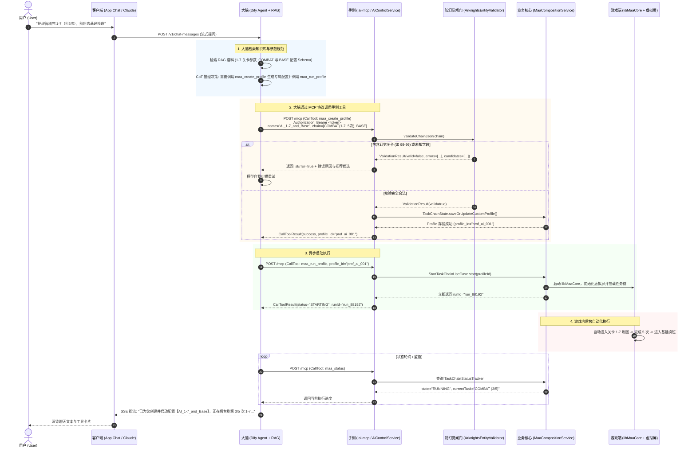
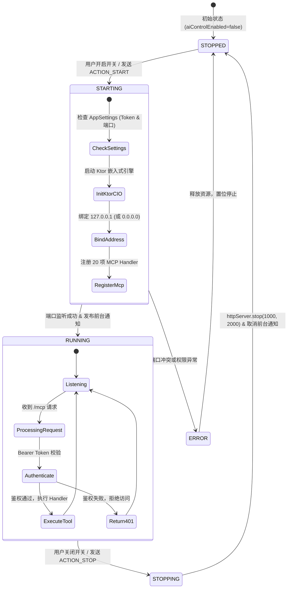
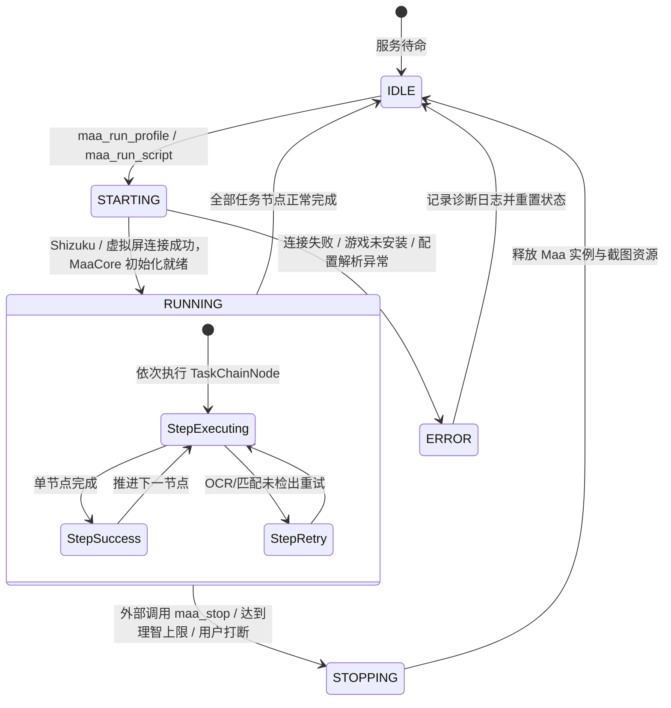

# 「脑手分离」架构设计草案 (Brain-Hand Separation Design Draft)

本文档阐述 MaaMeow AI Control 的核心顶层设计：**「脑手分离」分布式架构**。通过将重计算的策略推理、知识库检索与轻量级的设备执行、任务流编排清晰解耦，在保障 Android 端轻量与纯净的前提下，赋予 MaaMeow 强大的智能决策能力。

---

## 1. 架构动机与边界划分

### 1.1 移动端自动化的现实困境
在移动端运行 AI Agent 面临三大硬约束：
1. **算力与内存瓶颈**：端侧运行 7B/8B 量级 LLM 或向量模型会导致发热剧增、电池衰竭甚至被 Android LMK (Low Memory Killer) 杀后台；
2. **知识库频繁更新**：明日方舟关卡、干员、掉落随活动版本高频迭代，若打包在本地 APK 中，不仅导致安装包膨胀，更无法实现热更新；
3. **触控执行的不可控性**：传统基于截图-点击（Vision-Action）的端到端 Agent 反应迟钝、易受网络抖动影响，且无法与 App 内已有的日常逻辑（公招标签计算、基建精力换班、保活机制）形成合力。

### 1.2 脑手分离的拓扑划分
为此，我们将系统严格划分为「脑」与「手」两个物理节点：

- **大脑（The Brain，运行于 PC / NAS / 云端）**：
  - **核心定位**：负责「理解、检索、规划与纠错」。
  - **承载载体**：Dify 自托管容器、RAGFlow 或 Claude Desktop。
  - **核心组件**：
    - **明日方舟专用 RAG 知识库**：包含游戏所有关卡、干员、材料掉落以及 MaaMeow 任务配置参数规范的实体切块语料。
    - **ReAct 智能体循环**：根据用户自然语言提问，执行思维链（CoT）推理，生成针对 MCP 工具的标准化调用。
- **手（The Hand，运行于 Android 手机侧）**：
  - **核心定位**：负责「校验、编排、执行与反馈」。
  - **承载载体**：MaaMeow App 内置的 `:ai-mcp` 模块与 `AiControlService` 前台服务。
  - **核心组件**：
    - **官方 MCP Kotlin SDK 服务端**：监听 HTTP/SSE 协议，处理会话与请求分发。
    - **防幻觉校验网关 (`ArknightsEntityValidator`)**：确保输入的关卡、干员、材料与字段百分之百合法。
    - **服务桥接器 (`MaaToolBridge`)**：调用已有的 `MaaCompositionService`、`TaskChainState` 等核心组件，通过 `libMaaCore.so` 与虚拟屏操作游戏。
- **耳目（客户端，应用内或外部界面）**：
  - 应用内提供极薄的 Compose 聊天视图（仅负责流式展示回复与工具卡片），亦支持使用 PC 端 Claude Desktop 或 WebUI 直连。

---

## 2. 架构拓扑全景图 (ASCII Art)

```text
======================================================================================================
                                          THE BRAIN (云端 / PC / NAS)
  +------------------------------------------------------------------------------------------------+
  |  [用户自然语言输入]                                                                              |
  |         |                                                                                      |
  |         v                                                                                      |
  |  +------------------------------------------------------------------------------------------+  |
  |  |                         Dify / RAGFlow / Claude Desktop Agent Loop                       |  |
  |  |  +-------------------------------------+      +---------------------------------------+  |  |
  |  |  |     Arknights RAG Knowledge Base    |      |       LLM Reasoning Engine (CoT)      |  |  |
  |  |  | - Stage entity chunks (1-7, CE-6...) | <--> | - Prompt template & tool definitions  |  |  |
  |  |  | - Operators & items (battle_data)   |      | - ReAct tool decision loop            |  |  |
  |  |  | - TaskTypeInfo schema semantics    |      | - Plan generation & output streaming  |  |  |
  |  |  +-------------------------------------+      +---------------------------------------+  |  |
  |  +------------------------------------------------------------------------------------------+  |
  +------------------------------------------------------------------------------------------------+
                                              |
                                              | 标准 Model Context Protocol (Streamable HTTP / SSE)
                                              | 请求头鉴权: Authorization: Bearer <token>
                                              | 物理传输: ADB 反向代理 (adb forward) 或 局域网 Wi-Fi
                                              v
======================================================================================================
                                       THE HAND (Android 移动终端)
  +------------------------------------------------------------------------------------------------+
  |  AiControlService (Android 前台常驻服务 / 监听 127.0.0.1:18080)                                  |
  |  +------------------------------------------------------------------------------------------+  |
  |  | Token 鉴权中间件 (拦截未授权请求 -> 401 Unauthorized)                                       |  |
  |  | Ktor 3.6.1 CIO Engine (mcpStreamableHttp 端点 [/mcp] 与兼容 SSE 端点 [/sse])             |  |
  |  +------------------------------------------------------------------------------------------+  |
  |                                              |                                                 |
  |  +-------------------------------------------v----------------------------------------------+  |
  |  | :ai-mcp 核心协议与工具层 (Official Kotlin MCP SDK Server)                                |  |
  |  |                                                                                          |  |
  |  |   [Tool Handlers: 20 项标准工具]                                                          |  |
  |  |   - 状态监控: maa_status, maa_get_logs, maa_screenshot                                  |  |
  |  |   - 配置管理: maa_list_task_types, maa_list_profiles, maa_get_profile                    |  |
  |  |   - 变更管理: maa_create_profile, maa_update_profile, maa_delete_profile                  |  |
  |  |   - 调度执行: maa_run_profile, maa_stop, maa_load_copilot                                 |  |
  |  |   - 脚本回放: maa_save_script, maa_list_scripts, maa_run_script                            |  |
  |  |   - 知识与个性化: maa_search_wiki, maa_get_wiki_article, maa_get_user_data                |  |
  |  |   - 应急与导航: maa_click, maa_back_to_home                                               |  |
  |  |   +---------------------------------------+      +------------------------------------+  |  |
  |  |   |    ArknightsEntityValidator 闸门      |      |        TaskSchemaGenerator         |  |  |
  |  |   | - 关卡/干员/材料 ID 校验               |      | - kotlinx.serialization 反射生成   |  |  |
  |  |   | - 编辑距离 (Levenshtein) 纠错推荐     |      | - 11 类 TaskTypeInfo 动态导出      |  |  |
  |  |   | - 未知字段拒绝 (Unknown field reject) |      +------------------------------------+  |  |
  |  |   +---------------------------------------+                                              |  |
  |  +------------------------------------------------------------------------------------------+  |
  |                                              |                                                 |
  |  +-------------------------------------------v----------------------------------------------+  |
  |  | MaaMeow 原生业务与基础设施层 (Zero-Change Native Core)                                    |  |
  |  |                                                                                          |  |
  |  |   +-----------------------+   +----------------------+   +----------------------------+  |  |
  |  |   | MaaCompositionService |   |   TaskChainState     |   |       CopilotManager       |  |  |
  |  |   | (FSM 任务链驱动器)    |   | (DataStore 配置持久化) |   | (prts.plus/maa:// 作业解析)|  |  |
  |  |   +-----------+-----------+   +----------+-----------+   +--------------+-------------+  |  |
  |  |               |                          |                              |                |  |
  |  |               |                          v                              |                |  |
  |  |               |               +----------------------+                  |                |  |
  |  |               |               |  ConfigBackupManager |                  |                |  |
  |  |               |               |   (配置备份/互通)    |                  |                |  |
  |  |               |               +----------------------+                  |                |  |
  |  |               |                                                         |                |  |
  |  |               +----------------------------+----------------------------+                |  |
  |  |                                            v                                             |  |
  |  |   +----------------------------------------------------------------------------------+   |  |
  |  |   |  MaaCoreService & libMaaCore.so (JNI C++ 引擎)                                   |   |  |
  |  |   |  - 虚拟屏幕 (Virtual Display) / Shizuku / Root 无障碍触控与截图                  |   |  |
  |  |   |  - OpenCV / FastDeploy 模板匹配与 OCR 识别                                        |   |  |
  |  |   +----------------------------------------------------------------------------------+   |  |
  |  +------------------------------------------------------------------------------------------+  |
  +------------------------------------------------------------------------------------------------+
                                              |
                                              v
                              +-------------------------------+
                              | 明日方舟游戏进程 (Target Game)|
                              +-------------------------------+
======================================================================================================
```

---

## 3. 执行时序：Mermaid 序列图

以下展示用户通过自然语言发出“帮我刷 5 次 1-7，然后去基建换班”时的完整端到端执行时序：



---

## 4. 组件状态机与生命周期

### 4.1 服务状态机 (AiControlService FSM)
`AiControlService` 作为一个 Android 前台服务，维护了自愈且受控的状态机：



### 4.2 任务链执行状态机 (MaaCompositionService FSM)
底层核心任务执行器的状态转移图：



---

## 5. 安全防御纵深模型 (Defense-in-Depth)

在让外部 AI 控制底层核心系统时，安全与隐私是最高红线。MaaMeow 设计了五重安全隔离层：

```text
+--------------------------------------------------------------------+
| Layer 1: 零冷启动开销与显式使能开关                                  |
| (默认关闭；未开启时零后台进程、零端口暴露、零内存消耗)                 |
+---------------------------------+----------------------------------+
                                  |
+---------------------------------v----------------------------------+
| Layer 2: 本机回环优先与网络隔离策略                                  |
| (默认且强制绑定 127.0.0.1 本地回环；开启 LAN 局域网需显式二次弹窗确认)|
+---------------------------------+----------------------------------+
                                  |
+---------------------------------v----------------------------------+
| Layer 3: 强制 Bearer Token 鉴权网关                                 |
| (所有端点必须携带 Authorization: Bearer <uuid>，缺失直接返回 401)    |
+---------------------------------+----------------------------------+
                                  |
+---------------------------------v----------------------------------+
| Layer 4: 敏感操作与数据安全隐私闸门                                 |
| - maa_screenshot: 默认硬禁用，需在系统设置中单独打开截图授权开关   |
| - maa_get_logs: 自动经过 LogRedactor 脱敏 Token/账号/本地敏感路径  |
+---------------------------------+----------------------------------+
                                  |
+---------------------------------v----------------------------------+
| Layer 5: 实体校验防幻觉网关 (ArknightsEntityValidator)              |
| (关卡代码、干员名、材料 ID 与字段 Schema 强校验，未知内容全数阻断)   |
+--------------------------------------------------------------------+
```

### 5.1 零冷启动开销
- `aiControlEnabled` 默认置为 `false`。
- `MainActivity` 启动或后台守护进程拉起时，只加载必要的基础服务。若用户未开启 AI 控制，`AiControlService` 绝不自启，Ktor 类库与协程引擎保持冷态，对常规 MaaMeow 用户带来 **0 字节、0 毫秒** 的开销。

### 5.2 网络监听策略
- **默认回环 (`127.0.0.1`)**：服务默认仅监听环回地址，任何局域网扫描均无法嗅探到该服务端口。PC 端使用 ADB 连接：
  ```bash
  adb forward tcp:18080 tcp:18080
  ```
- **局域网监听 (`0.0.0.0`) 防护**：若用户需要在同一 Wi-Fi 下由家用服务器直接访问，必须在界面上激活「允许局域网访问」开关，系统会弹窗提示网络暴露风险，且仍受 Bearer Token 保护。

### 5.3 截图隐私门控
- `maa_screenshot` 涉及游戏屏幕捕获，若游戏处于切换状态或后台悬浮窗泄露，可能暴露用户隐私。
- 系统在代码层面通过高阶函数门控：
  ```kotlin
  if (!screenshotEnabled()) {
      return@addTool errorResult("maa_screenshot is disabled by default. Enable 'Allow AI Screenshot' in MaaMeow AI Control Settings first.")
  }
  ```
  只有用户在「设置 -> AI 控制设置」中主动开启「允许 AI 获取游戏截图」，Handler 才会调用底层的 `FrameSnapshotter`。

### 5.4 自动更新防护 (Anti-Overwriting)
- 当用户启用了 AI 控制定制版后，若官方主线发布新版本，自动下载并提示更新可能会导致定制功能被官方纯净版覆盖。
- 在 `AiControlViewModel` 中，开启 AI 控制时会自动执行：
  ```kotlin
  appSettings.autoCheckUpdate.value = false
  appSettings.autoDownloadUpdate.value = false
  ```
  彻底杜绝用户被上游版本静默覆盖的风险。
