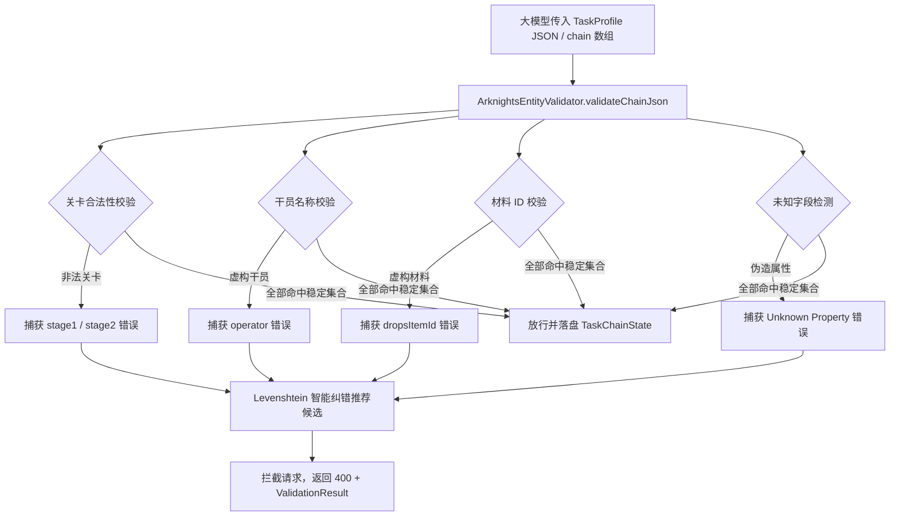

# 实体校验与防幻觉设计 (Anti-Hallucination Gate)

在 LLM 驱动的游戏自动化体系中，**大模型幻觉 (Hallucination)** 是导致系统崩溃或非预期行为的头号元凶。

常见的幻觉表现包括：
1. **生成虚构关卡**：如随口编造 `99-99`、`CE-99` 或活动不存在的 `PR-Z-9`；
2. **编造干员名称**：在肉鸽开局或基建换班时填入 `宇智波佐助`、`孙悟空` 或联动外作品人物；
3. **编造掉落材料 ID**：在掉落过滤字段中填入无意义的数值 `99999999`；
4. **生成未知配置字段**：在任务配置对象中捏造不存在的属性键名（如 `autoHeal`、`turboMode`）。

为彻底杜绝幻觉参数进入核心调度器，`:ai-mcp` 模块在所有涉及配置变更的工具（`maa_create_profile`、`maa_update_profile`、`maa_save_script`）前端设立了统一的 **防幻觉实体校验网关：`ArknightsEntityValidator`**。

---

## 1. 校验架构与防护矩阵



---

## 2. 核心校验维度与规则

### 2.1 关卡代号强校验 (`validateStage`)
- **数据依据**：内置于 `MaaResource` 中的合法关卡集合（包含主线、常驻物资关 `CE-1~6`、`LS-1~6`、`CA-1~5`、`AP-1~5`、`SK-1~5`、芯片本 `PR-A/B/C/D` 以及剿灭 `Annihilation`）与中英文常用别名映射表。
- **允许空值**：允许 `stage1 = ""`，表示沿用游戏内当前/最后一次战斗的默认关卡。
- **非法拦截**：对于任何未收录的关卡代码（如 `99-99`、`CE-99`），直接报告错误。

### 2.2 干员名称强校验 (`validateOperator`)
- **数据依据**：从 `battle_data.json` 提取的近千名真实干员名录，做小写去空格归一化。
- **作用范围**：肉鸽初始干员名 (`RoguelikeConfig.startingOper`)、干员养成目标以及基建疲劳恢复指定干员（菲亚梅塔的恢复对象）。
- **非法拦截**：任何未匹配真实明日方舟干员名录的输入均被拦截。

### 2.3 材料与掉落物品 ID 校验 (`validateItemId`)
- **数据依据**：`item_index.json` 中已注册的物品 ID 与中文道具名称映射表。
- **兼容性**：既支持传入标准数字 ID（如 `30012`），也支持直接传入中文名（如 `固源岩`），校验器会自动处理双向映射。

### 2.4 未知字段拦截 (Unknown Field Rejection)
- **数据依据**：`TaskSchemaGenerator` 为各个 `TaskParamProvider` 类提取的全部合法属性名称集合。
- **拦截逻辑**：遍历传入 JSON 对象的每个 Key。若存在任何一个既非标准通用字段（如 `id`、`name`、`type`、`enabled`、`order`）、又未在对应任务配置类中声明的 Key，判定为模型伪造字段并立即拦截，**严禁脏字段混入 DataStore**。

---

## 3. Levenshtein 智能纠错候选推荐算法

当模型或用户发生打字手滑或轻微拼写偏差时，直接生硬拒绝往往会导致大模型在重试时陷入无头苍蝇般的盲试。

`ArknightsEntityValidator` 内置了基于动态规划的 **编辑距离算法 (Levenshtein Distance)**。当检测到非法实体时，自动在合法候选库中搜寻编辑距离最近的 Top 5 候选并附带在返回体中：

```kotlin
fun suggestCandidates(
    input: String,
    candidates: Collection<String>,
    maxSuggestions: Int = 5,
    maxDistanceRatio: Double = 0.75,
): List<String> {
    if (candidates.isEmpty()) return emptyList()
    val lowerInput = input.lowercase()

    return candidates
        .asSequence()
        .map { candidate ->
            val dist = levenshteinDistance(lowerInput, candidate.lowercase())
            val score = dist.toDouble() / maxOf(input.length, candidate.length, 1)
            Triple(candidate, dist, score)
        }
        .filter { it.third <= maxDistanceRatio }
        .sortedWith(compareBy({ it.second }, { it.third }))
        .map { it.first }
        .distinct()
        .take(maxSuggestions)
        .toList()
}
```

---

## 4. 拦截响应报文与大模型自我修复

当输入非法关卡（例如指令要求“把刷理智设为 CE-99 刷龙门币”）时，MCP 工具返回给 LLM 的错误报文如下：

```json
{
  "valid": false,
  "errors": [
    {
      "path": "chain[0].config.stage1",
      "invalidValue": "CE-99",
      "reason": "Unknown stage ID/code 'CE-99' (not found in PRTS/Arknights-Tile-Pos or permanent stages)",
      "candidates": [
        "CE-6",
        "CE-5",
        "CE-4",
        "CE-3",
        "CE-2"
      ]
    }
  ]
}
```

大模型收到该显式反馈后，能够立即识别到自己的参数错误，并从 `candidates` 列表中挑选最符合业务语义的 `CE-6` 进行自动纠错并再次发起请求，从而实现 **100% 自愈的闭环防护**。
