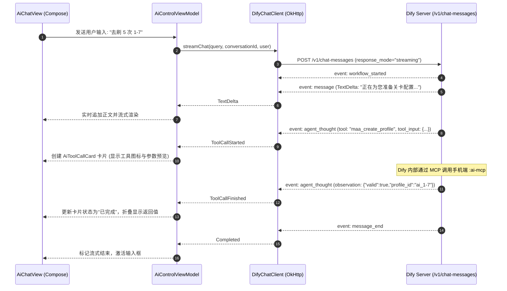

# 应用内 Compose 聊天客户端 (In-App Chat Client)

MaaMeow 为用户提供了一个极简、轻量的内置聊天交互界面（`AiChatView`），让用户无需切换至 PC 即可直接向 AI 发送指令、查看流式回复以及观测底层 MCP 工具的执行状态。

---

## 1. 架构定位：极致纯粹的薄客户端 (Thin Client)

在工程设计上，内置聊天界面严格遵循 **薄客户端原则 (Thin Client)**：
1. **零本地会话数据库**：不引入 Room、SQLite 或本地对话历史持久化，对话状态纯内存流式维护，随用随走；
2. **零业务 System Prompt 硬编码**：APK 内不包含任何游戏角色设定、AI 人设或业务系统提示词，所有提示词工程与知识逻辑均由服务端 Dify / RAGFlow 托管；
3. **零额外网络库**：复用项目中既有的全局 `OkHttpClient` 处理 HTTP 请求与 SSE 流式事件。

---

## 2. Dify SSE 流式协议解析 (`DifyChatClient`)

`DifyChatClient` 负责与 Dify 的开放 API `/v1/chat-messages` 建立长连接，并通过 Kotlin 协程 `callbackFlow` 将 Server-Sent Events (SSE) 事件流实时分发给 ViewModel。

### 2.1 支持的 SSE 事件类型

```kotlin
sealed interface DifyStreamEvent {
    // 任务元数据（任务 ID 与会话 ID）
    data class TaskInfo(val taskId: String, val conversationId: String) : DifyStreamEvent
    
    // 正文文本增量（用于打字机效果）
    data class TextDelta(val delta: String) : DifyStreamEvent
    
    // Agent 开始调用工具
    data class ToolCallStarted(val id: String, val toolName: String, val toolInput: String) : DifyStreamEvent
    
    // Agent 工具调用完成并获取观测值
    data class ToolCallFinished(val id: String, val toolName: String, val toolInput: String, val observation: String) : DifyStreamEvent
    
    // 消息生成结束
    data class Completed(val messageId: String, val conversationId: String) : DifyStreamEvent
    
    // 错误异常
    data class Error(val message: String) : DifyStreamEvent
}
```

### 2.2 事件处理时序



---

## 3. 工具调用摘要卡片 (`AiToolCallCard`)

为了让用户清晰感知 AI 的行动轨迹，`AiChatView` 在对话流中以独立的可折叠卡片渲染工具执行状态：

- **待执行/执行中**：显示工具名称（如 `maa_create_profile`）、齿轮/工具图标以及传入的 JSON 参数；
- **执行完成**：展示绿色的成功对勾，并将底层返回的执行结果（如 `run_id`、任务进度）折叠隐藏，用户可按需展开查阅底层报文。

---

## 4. 中止生成功能 (`stopGeneration`)

当大模型回复过长、陷入复读或用户意识到指令有误时，界面的「发送」按钮会自动切换为带有红色醒目图标的「中止」按钮（`Icons.Rounded.Stop`）。

点击中止后：
1. 本地协程取消网络读取流；
2. 向 Dify 发送停止信号请求：
   ```http
   POST /v1/chat-messages/{task_id}/stop
   Authorization: Bearer <dify-api-key>
   ```
3. Dify 服务端立即中断 LLM 推理循环并释放相关计算资源。
