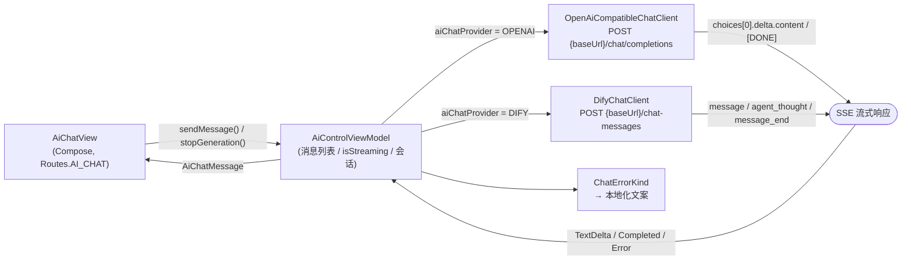
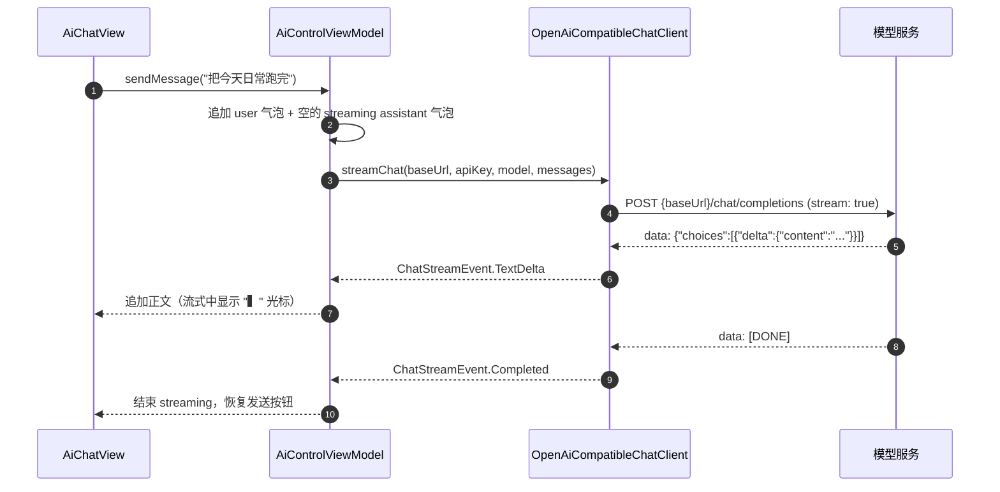
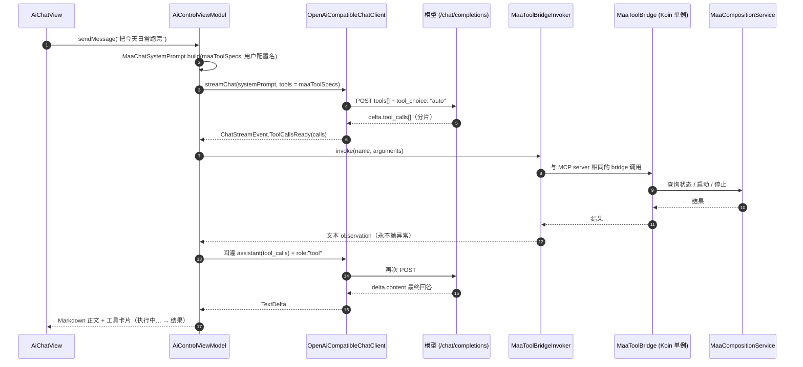

# 应用内对话：OpenAI 兼容 / Dify 双后端 (In-App Chat)

MaaMeow 内置的 GPT 风格对话界面（`AiChatView`）在手机侧直接与模型服务通信，不依赖 PC 上的 MCP 客户端。它支持两种后端：默认的 **OpenAI 兼容** `/chat/completions`，以及既有的 **Dify 应用 API**。

---

## 1. 架构



两个客户端都是薄封装：复用应用全局 `OkHttpClient` 与 `JsonUtils`，直接读取 `response.body.source()`，不整体缓冲响应体，也不引入新依赖。



---

## 2. 后端矩阵

| 维度 | `OPENAI`（默认） | `DIFY` |
|---|---|---|
| 请求 | `POST {baseUrl}/chat/completions` | `POST {baseUrl}/chat-messages`（`response_mode=streaming`） |
| 解析 | `choices[0].delta.content`；另有 `delta.reasoning` / `delta.reasoning_content`（思考）与 `delta.tool_calls[]`（工具调用）；`finish_reason` 或 `[DONE]` 视为结束 | `message` / `agent_thought` / `message_end` 等 Dify 事件 |
| 会话状态 | 协议无状态：每次把内存中的消息列表回放给服务端；工具循环的中间消息只在本次请求的工作副本里 | 由 `conversation_id` 维护，`clearChat()` 时重置 |
| 工具卡片 | 有（本地工具循环经 `MaaToolBridgeInvoker` 执行，卡片显示「执行中…」→ 结果） | 有（`AiToolCallCard`，来自 Dify 的 `agent_thought`） |
| 停止生成 | 取消协程 → 下一次工具执行前 `ensureActive()` 抛出取消；`callbackFlow` 的 `awaitClose` 调用 `call.cancel()` | 先取消本地流，再 `POST {baseUrl}/chat-messages/{task_id}/stop` |
| 展示名 | `vendorLabel()` 由 Base URL host 推断（DeepSeek / OpenAI / Kimi / SiliconFlow / GLM / Qwen，否则用 host） | `Dify · <baseUrl>` |

`vendorLabel()` 的判定顺序：`deepseek`→`DeepSeek`，`openai`→`OpenAI`，`moonshot`/`kimi`→`Kimi`，`siliconflow`→`SiliconFlow`，`bigmodel`/`zhipu`→`GLM`，`dashscope`/`aliyun`→`Qwen`，其余回退为 host 本身。该字符串用于首页卡片与对话页副标题（`aiChatTargetLabel` = `服务商 · 模型`）。

---

## 3. 助手能做什么（工具循环）

开启 AI 控制后，OpenAI 兼容后端不是「只会聊天」的文本机器人：它把 20 个本机 MCP 工具作为 `tools[]` 发给模型，在本地执行模型请求的调用，再把结果回灌，直到模型给出最终回答。工具清单与 MCP 服务端完全同源，所以「助手不知道有哪些工具」不再是问题。

### 3.1 一次工具调用的完整链路



`MaaToolBridgeInvoker` 通过 Koin 注入的同一个 `MaaToolBridge` 执行工具，与 `MaaMcpServerFactory.createServer` 的 handler 共享同一份状态与校验，不存在第二套实现。参数错误、未知工具、桥接异常都会变成给模型看的 `Error: ...` 文本，不会打断对话。

### 3.2 轮次上限与停止语义

| 项 | 值 / 行为 |
|---|---|
| 每回合最多轮次 | `MAX_TOOL_ROUNDS = 6`（一轮 = 请求 → 执行工具 → 再请求） |
| 每回合最多工具调用 | `MAX_TOOL_CALLS = 8`（跨轮累计） |
| 触顶 | 不再执行，正文追加「已达到本轮工具调用上限（6 轮 / 8 次），先停在这里；如需继续请再发一条消息。」（`ai_chat_tool_limit_reached`） |
| 停止按钮 | 取消协程；每执行下一个工具前 `coroutineContext.ensureActive()`，已请求但未执行的工具不会跑；正在进行的 SSE 由 `call.cancel()` 中止 |
| 工具卡片 | 先建为「执行中…」（`ai_chat_tool_running`），完成后显示结果；入参展示截断 240 字、observation 展示截断 280 字，卡片存储上限 400 字，模型收到完整结果 |

一轮内的多个工具调用串行执行；工具结果以 `role: "tool"`（带 `tool_call_id`）回灌，assistant 的 `tool_calls` 消息也会一并回灌，模型才知道自己请求过什么。

### 3.3 系统提示词与 grounding 规则

`MaaChatSystemPrompt.build(toolSpecs, aiControlEnabled, profileSummary)` 生成「宪法」，包含：

1. **身份**：MaaMeow 内置助手，用户说的「日常 / 刷图 / 清体力 / 收菜 / 肉鸽」都指明日方舟；
2. **工具事实**：20 个工具的 `name(required): description` 清单，并明确「你已经有工具，不要说看不到 tools / 没有连接 MCP」；
3. **7 条工作规则**（见下表）；
4. **用户真实配置名**：`TaskChainState` 的配置名 + `profile_id` + 已启用任务，当前激活项标注「（当前激活）」——避免「把日常跑完」被反问哪个配置；
5. **语言与风格**：跟随用户语言、先结论后数据、不复述原始 JSON。

工具清单不手写，直接遍历 `maaToolSpecs`。同一份 `maaToolSpecs` 同时供 MCP `tools/list`（`MaaMcpServerFactory.toolSpecs`）、OpenAI `tools[]` 与系统提示词使用，新增或改名工具只改这一处，**提示词不可能与 MCP 服务端漂移**。

| # | 规则 | 要点 |
|---|---|---|
| 1 | 需要事实先查工具 | 状态/进度→`maa_status`；配置→`maa_list_profiles` / `maa_get_profile`；干员与仓库→`maa_get_user_data`；游戏知识→`maa_search_wiki`，需全文再用 `maa_get_wiki_article` |
| 2 | 不许编造 | 关卡 id、干员名、任务类型、参数字段都必须来自工具；查不到就直说并列出候选 |
| 3 | 先查 schema | 配置结构不确定时先 `maa_list_task_types`，再 `maa_create_profile` / `maa_update_profile` |
| 4 | 长任务不阻塞 | `maa_run_profile` 拿到 `run_id` 后轮询 `maa_status` 再回报 |
| 5 | 触屏只用于排障 | `maa_click` 仅关闭意外弹窗/公告/网络错误，禁止手动打关或刷图 |
| 6 | 截图遵守设置 | `maa_screenshot` 被拒绝时不要反复重试，提示用户去设置开启 |
| 7 | 破坏性操作先说明 | `maa_delete_profile`、`maa_stop`、`force=true` 抢占运行中任务，执行前先用一句话说明后果 |

### 3.4 思考通道

推理模型的思维链走独立通道：OpenRouter 的 `delta.reasoning` 与 DeepSeek 的 `delta.reasoning_content` 被解析为 `ChatStreamEvent.ThinkingDelta`，累积到 `AiChatMessage.thinking`，UI 渲染为可折叠的「思考中… (N 字)」（`ai_chat_thinking_header`）。回答开始前默认展开（配合 `...` 占位避免「看起来卡死」），一旦出现正文自动折叠，仍可手动点开查看。最终回答依旧只取 `delta.content`，思考内容不会混进正文。

### 3.5 能力边界

- **工具执行依赖 AI 控制已开启**：关闭时 `tools` 为空列表，请求里根本不带 `tools` 字段，也不执行任何工具；提示词会如实说明「AI 控制已关闭，无法执行设备操作」。
- 工具循环的中间消息（assistant `tool_calls`、`role:"tool"`）只存在于本次请求的本地工作副本，不写回 UI 消息列表；UI 只显示最终正文与工具卡片。
- 每回合上限固定 6 轮 / 8 次，无「继续执行」按钮；需要更多调用请再发一条消息。

---

## 4. 设置键

来源：`app/src/main/java/com/aliothmoon/maameow/domain/models/AppSettings.kt`（DataStore 键名与默认值由 `@PrefKey` 声明）。

| 键名 | 含义 | 默认值 |
|---|---|---|
| `ai_chat_provider` | 对话后端，取 `OPENAI` / `DIFY`；非法值经 `AiChatProvider.parse()` 回退为 `OPENAI` | `OPENAI` |
| `ai_openai_base_url` | OpenAI 兼容 Base URL | `https://api.deepseek.com/v1` |
| `ai_openai_api_key` | API Key；为空时对话页显示「未配置模型密钥」卡片，且**不发出请求** | `""` |
| `ai_openai_model` | 模型名 | `deepseek-chat` |
| `ai_dify_base_url` | Dify 后端 Base URL | `http://127.0.0.1/v1` |
| `ai_dify_api_key` | Dify App API Key（`app-...`） | `""` |
| `ai_dify_user` | Dify `user` 字段 | `""` |

### 4.1 入口

对话页现在是底栏的一个主 Tab（不是压栈页），其余入口都只是切到这个 Tab。

| 入口 | 位置 | 条件 |
|---|---|---|
| 底部 Tab | 底栏第 2 个「AI」（`BottomNavTab.AI`，`bottom_nav_ai`，路由 `Routes.AI_CHAT`） | 仅 `aiControlEnabled` 开启时出现（`BottomNavTab.visibleTabs`）；关闭后若有页失去下标，由 `resolvePageForTabs` 按路由重算 |
| 首页卡片 | 首页「AI 对话」卡片（常规尺寸） | 仅开启时渲染 |
| 任务页卡片 | 任务/后台任务页顶部紧凑卡片（`compact = true`） | 同上 |
| 定时页卡片 | 定时任务列表顶部紧凑卡片（`compact = true`） | 同上 |
| 设置页 | 设置 → AI 控制与 MCP 服务 → 顶栏 `Icons.Rounded.Chat`，以及底部「打开应用内 AI 助手对话」按钮；两者都执行 `mainTabNavigator.navigateTo(BottomNavTab.AI)` 切换 Tab | 同上 |

卡片副标题为 `aiChatTargetLabel`（`服务商 · 模型`），未填密钥时显示「未配置模型密钥」。对话页顶部标题为「AI 助手对话」，并提供「清空当前会话」。

键盘弹出时 `MainScreen` 会隐藏底栏（`WindowInsets.isImeVisible`），对话页用 `Scaffold(contentWindowInsets = WindowInsets(0))` + `Modifier.imePadding()` 自行避让 IME，避免输入框被键盘遮住或与底栏 inset 叠加。

---

## 5. 错误映射

`OpenAiCompatibleChatClient.classifyHttpStatus()` 把 HTTP 状态码归一为 `ChatErrorKind`，`AiControlViewModel.chatFailure()` 再映射为文案；原始异常 / 响应体（截断 500 字符）作为可选中的小字附在气泡下方，方便复制反馈。

| `ChatErrorKind` | 触发条件 | 用户可见文案（`values/strings.xml`） |
|---|---|---|
| `NETWORK` | 连接失败 / 超时 / DNS | `无法连接到 %1$s:%2$d，请检查 Base URL 或网络` |
| `UNAUTHORIZED` | HTTP 401 / 403 | `API Key 无效或无权限` |
| `NOT_FOUND` | HTTP 404 | `接口路径不存在，请检查 Base URL 是否以 /v1 结尾` |
| `RATE_LIMITED` | HTTP 429 | `请求过于频繁或额度不足` |
| `SERVER` | HTTP 5xx | `服务端错误 %1$d` |
| `PROVIDER` | 流内 `{"error": {...}}` 业务错误 | 直接显示服务商 `error.message`（无则回退 UNKNOWN 文案） |
| `UNKNOWN` | 其它未分类状态码 / 解析失败 | `请求失败，请稍后重试` |

未配置密钥时不会发请求，直接显示 `未配置对话模型，请先在 AI 控制设置中填写 Base URL 与 API Key`，并附带「去填写」按钮跳转设置页。

---

## 6. 一键导入配置

设置 → AI 控制与 MCP 服务 页面提供「从链接或 JSON 导入」分组：粘贴框 + 「粘贴并导入」（直接读剪贴板，空剪贴板提示「剪贴板里没有可导入的文本」）+ 「导入」。也可以从外部深链 `maameow://ai-import?…` 触发：`MainActivity.dispatchAiChatImportIntent()` 只校验 URI 并放进 `AiChatImportRelay`，`AppNavigation` 收到后跳转 AI 设置页，`AiControlSettingsView` 消费后交给 `AiControlViewModel.importChatConfig()`。深链不依赖 AI 控制服务是否已启用；解析失败时静默忽略（既不跳页也不提示）。

导入成功后按后端写入对应设置键，并弹 Toast「已导入 `<服务商>` · `<模型 / Base URL>`」；密钥不会回显，也不会写进日志。成功导入会清空粘贴框。

### 6.1 支持的五种形态

| # | 形态 | 示例 | 解析结果 |
|---|---|---|---|
| a | Base URL + `#` 后的裸 Key | `https://api.deepseek.com/v1#sk-xxx` | `provider=OPENAI`，Base URL，API Key |
| b | Base URL + `#key=…&model=…` | `https://api.deepseek.com/v1#key=sk-xxx&model=deepseek-chat` | 同上 + 模型名；键名大小写不敏感，`_`/`-` 会被忽略（`api_key` = `apiKey`） |
| c | 空格或 `\|` 分隔的 Base URL 与 Key | `https://api.deepseek.com/v1 sk-xxx`<br>`https://api.deepseek.com/v1\|sk-xxx` | `provider=OPENAI`，Base URL，API Key |
| d | 导入深链 | `maameow://ai-import?baseUrl=https%3A%2F%2Fapi.deepseek.com%2Fv1&apiKey=sk-xxx&model=deepseek-chat&provider=OPENAI` | `provider` 取 `OPENAI` 或 `DIFY`（非法值回退 `OPENAI`）；`baseUrl`/`url`、`apiKey`/`key` 均可 |
| e | pi `models.json` 片段 | `{"providers":{"deepseek":{"baseUrl":"https://api.deepseek.com/v1","api":"openai-completions","apiKey":"sk-xxx","models":[{"id":"deepseek-chat"}]}}}` | 取第一个 `api` 为 `openai` 或以 `openai-` 开头的条目（`openai-completions` / `openai-responses`）；模型取该条目 `models[0].id` |

补充规则：

- 形态 a/b/c 只产出 `OPENAI` 后端；`baseUrl` 与 `apiKey` 必填，`model` 可选。Key 需以 `sk-` 开头（大小写不敏感）或长度 ≥ 16，否则判为不可用。
- 形态 a/b/c 的 `#`/空格/`|` 片段**不做**百分号解码（避免把 `+` 吃成空格）；深链的参数会做 URL 解码。
- 形态 e 接受 `baseUrl` 或 `base_url`；非法 Base URL 会被忽略（退化为不覆盖现有 Base URL），而不是导入失败。
- 形态 e 的 `apiKey` 若为空、以 `!` 开头（`!command`）或含 `$`（`$ENV` 插值），一律判为缺少可用 Key。

### 6.2 会被拒绝的输入

拒绝只回传中文说明，不带粘贴的密钥。

| `ImportFailure` | 触发条件 | 提示要点 |
|---|---|---|
| `EMPTY` | 去掉首尾空白与整体包裹的引号/反引号后为空 | 没有可导入的内容，请粘贴链接、Base URL + Key 或 `models.json` 片段 |
| `UNSUPPORTED_LINK` | 既不是 `{` / `[` 开头，也不是 `maameow://`，也不是 `http(s)://`；或 `maameow://` 前缀不对；或 Base URL 缺 host | 仅支持三类格式 / baseUrl 需为完整地址 |
| `INVALID_JSON` | 文本解析后不是 JSON 对象 | JSON 解析失败，请确认是完整的 pi `models.json` 片段 |
| `NO_PROVIDER_ENTRY` | 没有 `providers` 对象，或其中无 OpenAI 兼容条目 | `api` 需为 `openai-completions` 或 `openai-responses` |
| `OAUTH_CREDENTIAL` | 任意嵌套层级出现 `access_token` / `refresh_token` / `expires_at`，或 `"type":"oauth"` | 见 5.3 |
| `MISSING_KEY` | 无 Key；形态 a/b/c 的 Key 不像 Key；形态 e 的 `apiKey` 为空或使用 `$ENV` / `!command` | 补成真实 Key |

### 6.3 为什么 OAuth 订阅凭据不能导入

pi 的 `auth.json` 存的是订阅类 OAuth 凭据：访问令牌有效期很短，必须靠 refresh token 周期性地走供应商的刷新流程才能续期——这套刷新逻辑在 pi 的 Node 侧，APK 内没有常驻刷新循环，也没有对应的 OAuth 客户端。即便硬塞进 DataStore，导入后很快就会 401，且无法自愈。因此解析器在任何嵌套层级发现 OAuth 字段就直接返回 `OAUTH_CREDENTIAL`。

可行替代：改用同一服务的 **OpenAI 兼容端点 + 普通 API Key**，按形态 a/b/c 或 `maameow://ai-import` 链接导入；订阅额度问题请在服务商侧换取 API Key，而不是搬运 OAuth 令牌。

### 6.4 用 adb 验证深链

```bash
adb shell "am start -a android.intent.action.VIEW -d 'maameow://ai-import?baseUrl=https%3A%2F%2Fapi.deepseek.com%2Fv1&apiKey=sk-test-0123456789abcdef&model=deepseek-chat&provider=OPENAI'"
```

预期：App 前台并跳转到「AI 控制与 MCP 服务」页，弹出「已导入 DeepSeek · deepseek-chat」，服务商选中「OpenAI 兼容」且 Base URL / Key / 模型已填好。`&` 必须被引号保护，否则会被远端 shell 当成分隔符。

同一条链接重复执行时，`aiImportDispatched` 在同一 Activity 内只消费一次，会被静默忽略；重新测试先杀进程：

```bash
adb shell am force-stop com.aliothmoon.maameow
```

本地 mock 同样可用深链导入，但注意明文 HTTP 限制（`network_security_config.xml` 仅放行 `127.0.0.1` / `localhost` / `::1`）：

```bash
adb reverse tcp:18081 tcp:18081
adb shell "am start -a android.intent.action.VIEW -d 'maameow://ai-import?baseUrl=http%3A%2F%2F127.0.0.1%3A18081%2Fv1&apiKey=sk-local-test-1234&model=mock&provider=OPENAI'"
```

> 深链正文会出现在 shell 历史、`adb` 命令与可能的系统日志里，验证请用假 Key；真实 Key 建议用设置页的粘贴框导入。

---

## 7. 如何验证

目标：不消耗真实额度，验证「请求路径、SSE 解析、流式渲染、停止按钮、错误映射」。

### 7.1 在 PC 上起一个 10 行 mock

保存为 `mock_chat.py` 并运行 `python mock_chat.py`（监听 PC 的 18081 端口）：

```python
from http.server import BaseHTTPRequestHandler, HTTPServer
class H(BaseHTTPRequestHandler):
    def do_POST(self):
        self.send_response(200); self.send_header("Content-Type", "text/event-stream"); self.end_headers()
        for t in ["你好", "，这是", "本地 mock"]:
            self.wfile.write(f'data: {{"choices":[{{"delta":{{"content":"{t}"}}}}]}}\n\n'.encode())
        self.wfile.write(b'data: [DONE]\n\n')
    def log_message(self, *a): pass
HTTPServer(("127.0.0.1", 18081), H).serve_forever()
```

### 7.2 把手机端口反向映射到 PC

```bash
adb reverse tcp:18081 tcp:18081
```

`adb reverse` 的方向是 **手机端口 → PC 端口**：手机上的 `127.0.0.1:18081` 会转发到 PC 的 `127.0.0.1:18081`。
这也正好绕开明文 HTTP 限制——`app/src/main/res/xml/network_security_config.xml` 仅对 `127.0.0.1` / `localhost` / `::1` 放行 cleartext，直接把 `http://<PC-IP>:18081/v1` 填进 App 会被系统拦截。

### 7.3 在 App 内配置并观察

1. 设置 → AI 控制与 MCP 服务 → 服务商选「OpenAI 兼容」；
2. Base URL 填 `http://127.0.0.1:18081/v1`，API Key 任意非空（mock 不校验），模型名任意；
3. 进入对话页发送任意消息，预期看到三段文字逐字出现，末尾带 `▍`，结束后光标消失；
4. 流式过程中点停止按钮，预期 PC 侧连接被断开（`call.cancel()`），气泡停止增长；
5. 错误映射：停掉 mock 再发送 → `NETWORK` 文案（`无法连接到 127.0.0.1:18081...`）；Base URL 改成 `http://127.0.0.1:18081`（缺 `/v1`）→ mock 仍返回 200，需把 mock 改成对未知路径回 404 才能验证 `NOT_FOUND`；将响应改为 401 / 429 / 500 可分别验证其余分类。
6. 工具循环：在 mock 里打印请求体，开启 AI 控制后应看到 `tools`（20 项）与 `tool_choice: "auto"`；关闭后请求体完全不含 `tools`。把某一帧改成
   `data: {"choices":[{"delta":{"tool_calls":[{"index":0,"id":"call_1","type":"function","function":{"name":"maa_status","arguments":"{}"}}]},"finish_reason":"tool_calls"}]}`
   再以 `data: [DONE]` 结束，App 应在本地执行 `maa_status`、显示对应工具卡片，并用 `role:"tool"` 再发一次请求。

> 若使用真实服务商（DeepSeek / OpenAI / Kimi / SiliconFlow），把 Base URL 换成对应 `https://.../v1` 即可，无需 `adb reverse`。Ollama 同理：`adb reverse tcp:11434 tcp:11434` 后填 `http://127.0.0.1:11434/v1`。

---

## 8. 实现落点

| 职责 | 文件 |
|---|---|
| SSE 客户端与错误分类 | `app/src/main/java/com/aliothmoon/maameow/ai/OpenAiCompatibleChatClient.kt` |
| Dify SSE 客户端 | `app/src/main/java/com/aliothmoon/maameow/ai/DifyChatClient.kt` |
| 消息状态、后端分发、停止、错误文案 | `app/src/main/java/com/aliothmoon/maameow/presentation/viewmodel/AiControlViewModel.kt` |
| 对话界面 | `app/src/main/java/com/aliothmoon/maameow/presentation/view/settings/AiChatView.kt` |
| 工具循环 / 提示词 / 工具执行 | `app/src/main/java/com/aliothmoon/maameow/presentation/viewmodel/AiControlViewModel.kt`、`app/src/main/java/com/aliothmoon/maameow/ai/MaaChatSystemPrompt.kt`、`app/src/main/java/com/aliothmoon/maameow/ai/MaaToolBridgeInvoker.kt` |
| 工具元数据单一真源 | `ai-mcp/src/main/kotlin/com/aliothmoon/maameow/ai/mcp/MaaToolSpec.kt`（`maaToolSpecs`） |
| 底栏 Tab 与 IME 处理 | `app/src/main/java/com/aliothmoon/maameow/presentation/navigation/BottomNavigation.kt`、`MainScreen.kt` |
| 设置项与默认值 | `app/src/main/java/com/aliothmoon/maameow/domain/models/AppSettings.kt` |
| 导入解析（纯文本 → 配置字段） | `app/src/main/java/com/aliothmoon/maameow/ai/ChatConfigImport.kt` |
| 深链一次性搬运 | `app/src/main/java/com/aliothmoon/maameow/ai/AiChatImportRelay.kt` |
| 深链入口 | `app/src/main/java/com/aliothmoon/maameow/MainActivity.kt`（`dispatchAiChatImportIntent()`）、`app/src/main/AndroidManifest.xml`（`maameow://ai-import`） |
