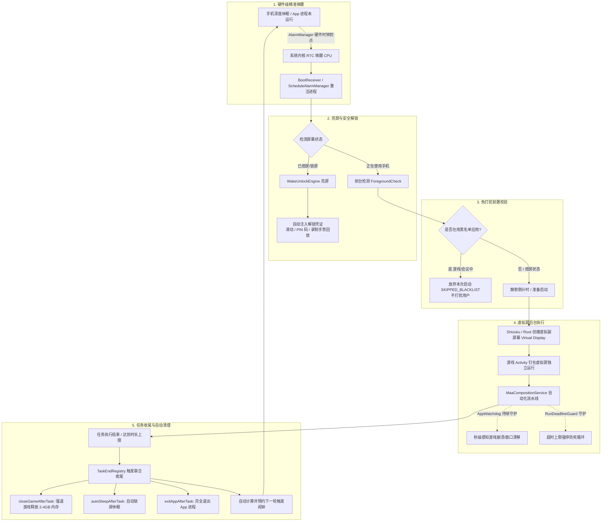

# 定时任务、自动唤醒与后台自启机制 (Scheduled Tasks, Wake-Unlock & Self-Recovery)

> **“有定时重启功能吗？比如说定时任务，就自己在后台重启了？”**  
> **答案：完全支持，且原生实现了无需人工干预的「全自动无人值守定时闭环」！**

在 Android 移动端自动化工具中，很多用户遇到的最大痛点是：“定时任务到点了，手机熄屏或者 App 被系统杀后台了，根本无法按时启动；或者哪怕启动了，卡在锁屏界面输不了密码，最后直接失败”。

MaaMeow 从底层架构设计之初，就将 **全链路无人值守** 作为核心能力。从系统的硬件级时钟闹钟触发、自动亮屏、智能解锁、Shizuku 虚拟屏免打扰渲染，到任务完成后的关游戏、锁屏休眠、甚至自我销毁进程退出，全部由内部各服务组件精密协同完成。

---

## 1. 核心解答：全自动无人值守定时闭环

MaaMeow 无需依赖任何第三方自动化辅助工具（如 Tasker、Macrodroid），即可通过原生技术栈实现完整的定时自启闭环：

### 1.1 全生命周期闭环流程图



### 1.2 闭环五大关键机制详解

#### (1) 到点后台自启动 (Hardware Exact Alarm & Doze Piercing)
- **底层时钟驱动**：基于 Android 系统 `android.app.AlarmManager` 硬件级时钟接口。在开启「使用硬件闹钟 (`useAlarmClock`)」选项时，底层采用 `setAlarmClock(AlarmClockInfo(...))`，具备系统最高级别的时钟唤醒权限，**100% 击穿 Android 深度休眠（Doze Mode）与各大厂商的电池墓碑机制**。
- **冷进程与关机自愈 (`BootReceiver`)**：即使 MaaMeow 进程已被系统清理或手机刚刚重启，`BootReceiver` 监听了 `ACTION_BOOT_COMPLETED`、`ACTION_MY_PACKAGE_REPLACED`（应用更新）、`ACTION_TIMEZONE_CHANGED`（时区变更）以及精确闹钟权限变更事件。系统启动完成后会自动拉起重排任务，重新恢复所有已启用的定时策略。
- **时钟回拨保护**：当系统进行网络校时或手动调表时，`ScheduleAlarmManager` 通过持久化记录上次触发时间戳，确保不会因为时钟回拨而重复触发同一周期的任务。

#### (2) 自动点亮屏幕与解锁 (`WakeUnlockEngine`)
定时任务触发时，手机通常处于熄屏锁屏状态。`WakeUnlockEngine` 协同提权服务（Shizuku 或 Root）完成自动亮屏与解锁，原生支持三种凭证类型：
1. **轻触滑动解锁 (Swipe)**：适用于未设置锁屏密码、或已通过 SmartLock / 蓝牙手环保持解锁的设备。
2. **数字 PIN 码解锁 (PIN)**：通过提权端 IPC 模拟键盘事件，自动向锁屏 Keyguard 界面注入密码数字流并提交验证。
3. **独创手势轨迹录制与回放解锁 (Gesture Record & Replay)**：
   - 针对九宫格图案解锁或复杂的厂商滑动解锁，MaaMeow 独创了底层硬件级触控录制回放机制。
   - 在配置界面开启录制后，提权端直接监听底层 Linux 输入设备节点（`/dev/input/event*`），毫秒级记录用户手指划过屏幕的每一个 `ABS_MT_POSITION_X`、`ABS_MT_POSITION_Y`、压力值与时间间隔，持久化为 JSON 轨迹序列。
   - 唤醒时，提权端以 1:1 的真实物理轨迹和时序重新注入事件，完美绕过厂商各种图案验证与滑块阻尼检测。
- **一键锁屏自测**：在设置页内点击「测试解锁」，设备会立即锁屏熄屏并在 3 秒后自动亮屏并回放解锁，方便用户即时验证凭证是否有效。

#### (3) 后台虚拟屏免打扰运行 (Virtual Display)
- **主屏零干扰**：借助 Shizuku 或 Root 权限，MaaMeow 调用 Android 隐藏 API 创建私有虚拟显示器（Virtual Display，默认 1280×720 分辨率与独立 DPI）。
- **游戏隐身挂载**：明日方舟游戏客户端直接启动并绑定在虚拟副屏幕上渲染运行，主屏幕保持完全空闲。用户可以一边刷微信、看 B 站，或者直接锁屏放入口袋，后台挂机过程丝毫不受打扰。

#### (4) 任务结束自动收尾清理 (Zero-Footprint Post-Task Cleanup)
任务完成后，若后台一直常驻游戏与自动化服务，会导致电量剧烈损耗与发热。MaaMeow 在 `LaunchPipeline` 与 `TaskEndRegistry` 中设计了三连清理策略：
- **`closeGameAfterTask`（自动关游戏释放内存）**：任务自然结束、掉线中止或超时强停后，立即销毁虚拟副屏并通过 `am force-stop` 强杀游戏进程，瞬间释放 2GB ~ 4GB 内存。
- **`autoSleepAfterTask`（自动锁屏休眠）**：调用 `WakeUnlockEngine.lockAndSleep()`，关闭屏幕背光并恢复锁屏状态，使手机重回深度低功耗待机。
  - *防打扰保护 (`skipAutoSleepIfAwake`)*：如果任务触发时用户本就在使用手机（亮屏未锁屏），则任务结束后会自动跳过锁屏，避免正在看手机的用户突然被锁屏。
- **`exitAppAfterTask`（完全退出 App 释放系统常驻）**：通过 `AppTerminator` 释放所有电量唤醒锁（WakeLock），断开提权服务连接，并调用进程退出指令彻底杀掉 MaaMeow 自身前后台进程，实现真正的**零常驻、零后台内存消耗**。

#### (5) 自动循环预约与下次调度 (Next-Cycle Scheduling)
每次任务完成后（或在策略创建/保存时），`ScheduleAlarmManager` 会自动根据调度策略计算并预约下一次硬件闹钟：
- **固定时间模式 (`FIXED_TIME`)**：支持勾选指定星期（如周一到周五），并设定每日多个执行时刻（如 `07:00`、`12:30`、`21:00`），每日准点自启。
- **间隔周期模式 (`INTERVAL`)**：指定首次开始时间后，按照固定周期（如 `180` 分钟）无限循环自启，精准契合明日方舟的理智回复节拍（每 6 分钟恢复 1 点理智，180 分钟恢复 30 点）。

---

## 2. 异常自动恢复与守护机制

全自动无人值守最怕的就是中途卡死、闪退导致手机发热一整夜。MaaMeow 内置了多层防御机制：

### 2.1 `AppWatchdog`：游戏闪退感知与虚拟屏窗口防漂移

`AppWatchdog` 运行在后台协程中，以 5 秒为一个周期高频监视游戏运行状态：

1. **游戏闪退/崩溃秒级感知**：
   - 使用 `AppAliveChecker` 轮询游戏进程状态。为防止游戏在热重载或切号时瞬间掉线导致的误判，采用了确认机制（`DEAD_CONFIRM_POLLS = 2`）。
   - 确认游戏非正常死亡后，立即抛出 `appDiedEvent`，通知调度核心中止无意义的识图空转，直接触发收尾关屏机制，避免电量浪费。
2. **虚拟屏窗口漂移防脱轨 (Display Repin)**：
   - 在某些国内深度定制系统（如小米 HyperOS/MIUI、OPPO ColorOS、vivo OriginOS）中，系统的激进后台优化有时会强行将处于虚拟屏上的应用拉回主屏幕，或者变成小窗/悬浮窗。
   - `AppWatchdog` 一旦感知到游戏窗口离开了虚拟显示器（`displayDriftEvent`），会先给予 5 秒宽限期（`REPIN_GRACE_MS`，避开 SDK 登录弹窗），随后主动调用 `moveAppToBackgroundDisplay` 将游戏窗口重新强制钉回虚拟屏。最多自动重试 3 次（`MAX_REPIN_ATTEMPTS = 3`），彻底解决脱轨问题。

### 2.2 `ShizukuDownMonitor`：提权服务断连监测与预警

- **痛点**：通过无线 ADB 激活的 Shizuku 在手机重启或网络切换后可能失效。若用户配置了定时任务，但 Shizuku 处于断开状态，任务到点必败。
- **提前防御**：`ShizukuDownMonitor` 在开机广播后或日常运行时，使用独立的系统唤醒闹钟排查提权状态。如果检测到“有启用的定时任务，但 Shizuku 服务已停止”，会在系统通知栏推送高优先级警告卡片（附带直达启动 Shizuku 的快捷按钮），提前提醒用户补齐权限，杜绝到点失败。

### 2.3 `RestartActivity`：独立 `:restart` 进程热重启机制

在 Android 运行时中，主进程如果发生 native 崩溃、底层动态库句柄损坏，或者在切换关键系统档案时尝试通过 `Process.killProcess(Process.myPid())` 重启自己，系统经常会将主进程及其尚未发出的 PendingIntent 一并全部销毁，导致应用永久死亡。

为此，MaaMeow 在 `AndroidManifest.xml` 中配置了一个专属的独立辅助进程：

```xml
<activity
    android:name=".utils.RestartActivity"
    android:exported="false"
    android:process=":restart"
    android:theme="@android:style/Theme.Translucent.NoTitleBar" />
```

- 当需要热重启时，主进程将自身的 PID 作为参数传递给 `RestartActivity` 并启动该 Activity；
- 运行在 `:restart` 独立进程中的 `RestartActivity` 会干净利落地执行 `Process.killProcess(mainPid)` 杀掉旧主进程，确保底层 JNI、C++ 显存与锁资源彻底被操作系统回收；
- 随后，以 `FLAG_ACTIVITY_NEW_TASK or FLAG_ACTIVITY_CLEAR_TASK` 从桌面重新冷拉起全新的主进程，最后通过 `Runtime.getRuntime().exit(0)` 自我销毁。整个过程在几十毫秒内完成，杜绝任何僵尸线程和内存泄漏。

### 2.4 运行时长上限守护 (`RunDeadlineGuard`)

- **防死循环兜底**：在后台无人值守环境下，若游戏遭遇极端网络卡顿或出现无法识别的异常弹窗，识图引擎可能会持续重试。
- **单调时钟计时**：用户可配置后台任务最大允许运行时间（默认 240 分钟，支持自由调整）。`RunDeadlineGuard` 基于 Linux 内核单调递增时基 `SystemClock.elapsedRealtime()` 计时，不受系统时间修改或网络 NTP 校时干扰。
- **超时强停**：一旦达到截止时间，原子性切换执行状态至 `STOPPING`，并将终止原因标记为 `StopOrigin.RUN_DURATION_LIMIT`，强制停止所有子任务并执行后置关游戏、锁屏和退出流程。

---

## 3. 界面操作指南 (UI Configuration Guide)

在 MaaMeow 界面中配置全自动无人值守定时闭环极其简便：

### 3.1 导航入口与工具栏按钮

进入 App，点击底部导航栏的 **「定时任务」** Tab，顶部应用栏从左至右提供了 5 个核心操作入口：

| 图标 | 名称 | 功能说明 |
|:---:|:---|:---|
| ⏰ | **精确闹钟设置** | 仅在系统未授予精确闹钟权限时出现，点击一键跳转至系统设置页授权 |
| 🔓 | **唤醒与解锁** | 配置锁屏唤醒策略、录制手势轨迹、测试自动解锁功能 |
| 🚫 | **黑名单应用** | 选择高优先级应用（如竞技游戏、会议软件），前台使用这些应用时定时任务自动回避 |
| 📜 | **触发日志** | 查看历史定时的触发时间、唤醒耗时、执行状态及跳过原因（如黑名单跳过、电量过低等） |
| ➕ | **新建策略** | 创建一条新的定时自动化策略 |

---

### 3.2 创建与编辑定时策略步骤

1. 点击右上角 **「➕」** 按钮进入编辑页；
2. **基本信息**：
   - 输入策略名称（例如：“每日晨间基建换班”、“凌晨夜间理智清空”）；
   - 选择关联的 **任务配置 (TaskProfile)**（例如默认 profile、纯刷理智配置、或牛杂专精配置）。
3. **选择调度类型**：
   - **固定时间模式 (FIXED_TIME)**：
     - 在「生效星期」中勾选周一至周日；
     - 点击「添加时间」，通过时间滚轮添加执行时间点（例如 `07:30`，支持单日添加多个时间点）；
   - **间隔周期模式 (INTERVAL)**：
     - 点击选择首次执行的日期与时刻；
     - 输入循环周期分钟数（例如输入 `180`，即每隔 3 小时自动循环启动一次）。
4. **高级选项三栏配置**：
   通过分段按钮（SegmentedButton）可以在「触发」、「运行」、「结束」三栏之间切换：

   - **「触发」栏 (Trigger)**：
     - `强制重新开始 (forceStart)`：若到点时已有任务在运行，是否先强制终止当前任务再拉起本策略；
     - `手机使用中静默启动 (silentStartWhenInUse)`：如果到点时用户正在玩手机，不强制弹窗，改为在通知栏静默倒计时，并在后台悄悄启动虚拟屏。
   - **「运行」栏 (Running)**：
     - `自动低功耗屏保 (autoScreenSaver)`：运行期间显示全黑低功耗屏保防烧屏，并显示运行进度；
     - `硬件关闭屏幕 (hardwareScreenOff)`：熄屏挂机时直接切断物理屏幕供电，极大程度降低功耗。
   - **「结束」栏 (Finish) —— 关键收尾配置**：
     - `任务结束后自动锁屏 (autoSleepAfterTask)`：**建议勾选**。任务跑完后自动锁屏熄屏。
     - `唤醒时跳过休眠 (skipAutoSleepIfAwake)`：**建议勾选**。如果启动时用户正好亮屏在用手机，收尾时不会强行给用户锁屏。
     - `任务结束后关闭游戏 (closeGameAfterTask)`：**强烈建议勾选**。任务结束后立即杀掉明日方舟后台进程，释放 2GB+ 内存，防止后台发热。
     - `任务结束后退出应用 (exitAppAfterTask)`：**建议勾选**。完全终止 MaaMeow 进程，不常驻后台，等待下一次闹钟唤醒。
5. 点击页面底部 **「保存」**，策略即刻激活并在系统后台注册闹钟。

---

### 3.3 设置唤醒与解锁凭证 (Wake & Unlock)

点击顶部导航栏的 **「🔓」** 图标进入「唤醒与解锁」设置：

1. **选择唤醒解锁方式**：
   - **滑动解锁 (Swipe)**：如果手机没有设置锁屏密码（或已由手表/手环 SmartLock 自动解锁），直接选择此项；
   - **数字密码 (PIN)**：输入你的锁屏 4 位或 6 位数字 PIN 码。密码以加密形式安全保存在本地安全 DataStore 中；
   - **手势轨迹录制 (Gesture)**：
     - 点击「开始录制」；
     - 手机将自动锁屏，随后请用手指按照日常习惯**完整划开一次九宫格锁屏**；
     - 解锁成功后回到 MaaMeow，页面会提示“录制成功，共捕捉 X 个触控步骤”；
2. **一键自测验证**：
   - 配置完成后，点击下方的 **「测试解锁」**；
   - 手机会立刻自动锁屏熄屏，请静候 3~5 秒，观察手机是否能够自主点亮屏幕并顺利划开锁屏进入主页。如果弹出 Toast 提示“解锁成功”，说明凭证配置无误。
3. **开启「使用硬件闹钟 (`useAlarmClock`)」**：
   - 确保此项处于开启状态。系统状态栏会显示一个标准系统闹钟小图标，这是保证手机深度睡眠时能够 100% 被唤醒的硬件级通行证。

---

### 3.4 配置黑名单应用回避 (App Blacklist)

点击顶部导航栏的 **「🚫」** 图标进入「黑名单应用」设置：

- 界面会自动列出手机中已安装的所有第三方应用；
- 在搜索框中输入或直接勾选你的重要应用，例如：
  - MOBA/FPS 竞技游戏（王者荣耀、和平精英、原神等，防止后台自动挂机占用大量 CPU/GPU 引起主游戏掉帧）；
  - 办公/会议软件（腾讯会议、钉钉、Zoom、企业微信等，防止开会时突然后台唤醒）；
  - 影音相机软件（录屏、拍照等）。
- **运行逻辑**：当定时闹钟到点唤醒后，`LaunchPipeline` 会首先检查当前物理主屏幕的前台应用包名。如果检测到用户当前正在使用黑名单中的 App，MaaMeow 会立即放弃本次启动，在触发日志中记录 `SKIPPED_BLACKLIST（前台命中黑名单：XX 应用）`，绝不干扰用户当前的沉浸体验。

---

## 4. 常见问题排查与 OEM 厂商保活优化

为了确保无人值守定时自启 100% 稳定运行，请检查以下系统设置：

### 4.1 必要权限核对表

| 权限项 | 作用 | 检查路径 |
|:---|:---|:---|
| **精确闹钟权限 (`SCHEDULE_EXACT_ALARM`)** | 保证定时任务在设定的秒级时刻精准触发 | 系统设置 -> 应用管理 -> 特殊应用权限 -> 闹钟与提醒 -> 允许 MaaMeow |
| **电池无限制 / 忽略电池优化** | 防止系统在长时间待机时强杀唤醒广播 | 系统设置 -> 应用管理 -> MaaMeow -> 省电策略 -> 无限制 |
| **自启动 / 后台弹出界面** | 允许闹钟到点时由后台广播直接拉起前台服务 | 手机管家 -> 应用自启动管理 -> 允许自启动、允许关联启动 |
| **Shizuku 权限 / Root 提权** | 执行免打扰虚拟屏创建、唤醒亮屏与触控注入 | Shizuku App -> 已授权应用列表包含 MaaMeow |

### 4.2 各主流品牌系统优化建议

- **小米 / Redmi (HyperOS / MIUI)**：
  - 应用信息 -> 省电策略 -> 设置为「无限制」；
  - 应用信息 -> 权限管理 -> 开启「后台弹出界面」与「常驻通知」；
  - 最近任务列表中，下拉 MaaMeow 卡片点击「小锁」图标加锁后台。
- **华为 / 荣耀 (HarmonyOS / MagicOS)**：
  - 设置 -> 电池 -> 启动管理 -> 将 MaaMeow 改为「手动管理」，全部勾选「允许自启动」、「允许关联启动」、「允许后台活动」。
- **OPPO / 一加 / realme (ColorOS)**：
  - 设置 -> 应用 -> 应用启动管理 -> 关闭自动管理，开启「允许自启动」与「允许后台活动」；
  - 电池 -> 更多设置 -> 耗电异常优化 -> MaaMeow 选择「不优化」。
- **vivo / iQOO (OriginOS)**：
  - 设置 -> 电池 -> 后台高耗电 -> 允许 MaaMeow 高耗电运行；
  - 设置 -> 应用 -> 自启动管理 -> 允许自启动。

---

## 5. 总结

MaaMeow 的定时自动化绝不是简单的“设置一个延时然后祈祷系统不杀后台”，而是通过：
1. **硬件级时钟 (`AlarmManager.setAlarmClock`)** 解决“叫得醒”的问题；
2. **智能解锁引擎 (`WakeUnlockEngine`)** 解决“进得去”的问题；
3. **虚拟副显示器 (Virtual Display)** 解决“不打扰”的问题；
4. **全套收尾与自毁机制 (`TaskEndRegistry` + `exitAppAfterTask`)** 解决“省电不发热”的问题；
5. **四重守护看门狗 (`AppWatchdog` + `ShizukuDownMonitor` + `RestartActivity` + `RunDeadlineGuard`)** 解决“稳得住”的问题。

配置一次后，即可将手机变成一台全天候、全自动、用完即走、随叫随到的明日方舟智能托管终端！
