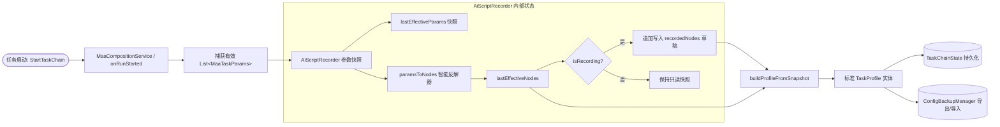

# 任务录制与配置回放互通 (Script Recorder & Interoperability)

在将 AI 引入自动化系统的过程中，一个关键的用户体验诉求是：**“让 AI 帮我配好的复杂流程，或者我自己手动跑通的一次流程，能够固化为永久脚本，随时一键调用，并能与常规配置完全互通”**。

`AiScriptRecorder` 正是实现这一双向资产互通的核心纽带。

---

## 1. 业务痛点与设计目标

1. **AI 探索结果的资产化**：AI 可能会根据当前活动临时计算出一组最优刷图、碎石和换班策略。如果这些参数只在内存中一次性跑完，用户下次仍需重复与 AI 对话。
2. **零差异还原与互通**：AI 生成的脚本不能发明一套专属私有格式，必须直接等同于 MaaMeow 既有的 `TaskProfile`。
3. **备份生态兼容**：生成的脚本必须可以直接被 `ConfigBackupManager` 打包进 JSON 备份文件，并能由其他未开启 AI 的设备无缝导入。

---

## 2. `AiScriptRecorder` 核心机制

`AiScriptRecorder` 挂载在任务链启动链路中，维护了响应式的状态流（`StateFlow`）：



### 2.1 运行时参数捕获 (`onRunStarted`)
每当任务链启动时，底层执行器会将各个节点解析出来的最终有效参数集合 `List<MaaTaskParams>` 回传给录制器：
- **节点源关联**：若参数携带了 `TaskSlot(nodeId, slotIndex)`，录制器会优先保留原始节点的 ID、名称与开关状态；
- **反解还原**：对于无源的底层参数，通过 `paramsToNodes()` 将 JSON 参数逆向解析为强类型的 `TaskParamProvider`（如 `FightConfig`、`InfrastConfig`、`RecruitConfig`）。

---

## 3. 零差回放证明 (Zero-Diff Verification)

在 `AiScriptRecorderAndClientTest.kt` 单元测试中，我们构建了严苛的四步闭环测试：
1. **步骤 1：构建原始 UI 链路 A**
   包含完整的登录唤醒、1-7 刷理智、自动公招、基建换班、信用购物与领取邮件 6 个复杂节点；
2. **步骤 2：模拟实际运行并录制参数**
   触发 `onRunStarted`，录制器捕获各节点的实际 `MaaTaskParams`；
3. **步骤 3：保存为脚本并清空 UI 状态**
   调用 `buildProfileFromSnapshot("SavedScriptA")` 得到 `TaskProfile`，随后将 UI 当前链路全部清空；
4. **步骤 4：加载脚本回放并比对参数差异**
   将保存的 Profile 节点重新转换为 `MaaTaskParams`，与步骤 1 的原始参数进行逐字段比对。

### 单测断言与零差证明：
```kotlin
@Test
fun `record A to save script to clear UI to replay produces empty parameter diff and round-trips with ConfigBackup`() {
    // 1. 原始链 A 启动运行并由录制器截获
    recorder.onRunStarted(effectiveParamsA, originalNodes)

    // 2. 导出为 Profile 并清空上下文
    val savedProfile = recorder.buildProfileFromSnapshot("BackupProfile")
    assertNotNull(savedProfile)

    // 3. 经过 ConfigBackupManager 序列化与反序列化回环
    val backupJson = json.encodeToString(ConfigBackup.serializer(), configBackup)
    val restoredBackup = json.decodeFromString(ConfigBackup.serializer(), backupJson)

    // 4. 重放参数并验证差异
    val replayedParams = restoredNodes.map { it.toMaaTaskParams() }
    val diff = calculateParamDiff(effectiveParamsA, replayedParams)
    
    // 断言：参数差异必须为 0
    assertTrue("Parameter diff between recorded and replayed must be empty", diff.isEmpty())
}
```

测试证明：**无论经过多少次录制、保存、清空和重放，所有任务类型（COMBAT、BASE、RECRUIT 等）的字段值与类型均 100% 保持一致，参数差异为 0**。

---

## 4. MCP 工具调用与脚本自动化

通过 MCP 协议，大模型可以自由操纵这一套录制与回放流水线：

```bash
# 1. 查阅当前已有的脚本列表与正在录制的草稿
CallTool: maa_list_scripts {}

# 2. 将最近一次成功的战斗链保存为独立脚本
CallTool: maa_save_script {
  "name": "剿灭挂机与换班脚本"
}

# 3. 指定运行已保存的脚本
CallTool: maa_run_script {
  "profile_id": "profile_script_20261108",
  "force": true
}
```

通过这一闭环设计，用户无需重复配置复杂的任务参数，AI 探索出的一套最佳实践可以随时转变为长期资产。
